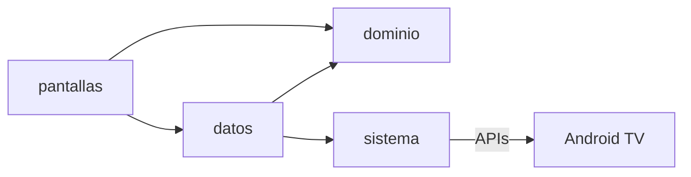

# Arquitectura

La app de TV reproduce siempre desde la memoria de la TV; en la Fase 2 la nube solo decide qué
debe tener cada TV y se lo hace descargar.

| Capa | Paquete | Para qué |
|---|---|---|
| `app/` | `pe.inkaterra.tv.app` | Arranque, tema, navegación e idioma |
| `dominio/` | `pe.inkaterra.tv.dominio` | Kotlin puro, sin Android: reglas de contenido, inactividad, campañas |
| `datos/` | `pe.inkaterra.tv.datos` | Biblioteca local, ajustes y, en la Fase 2, red y sincronización |
| `sistema/` | `pe.inkaterra.tv.sistema` | Lo que toca Android TV: decodificadores, USB, protector de pantalla, arranque |
| `pantallas/` | `pe.inkaterra.tv.pantallas` | Lo que ve el huésped (Compose for TV); no toca archivos ni red |

- `dominio/` no importa Android: se prueba en la PC.
- Lo que toca el sistema va detrás de una interfaz con un doble para las pruebas.

Pendiente de los sprints: navegación y biblioteca (sprint 1), reproductores (sprint 2) y
promociones (sprint 4).
