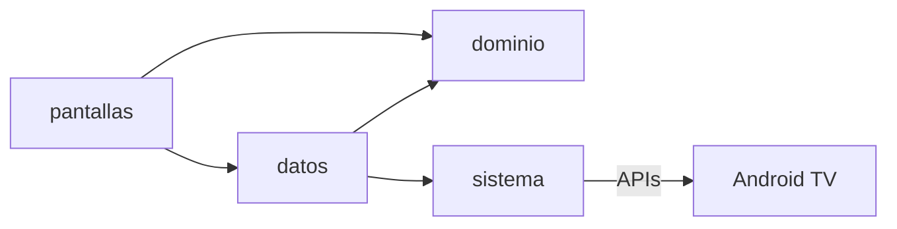
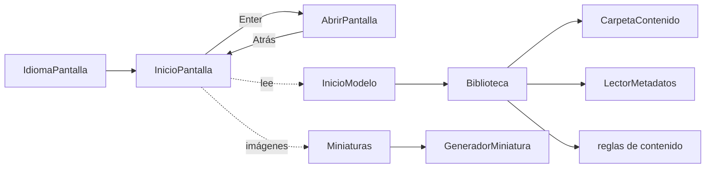

# Arquitectura

La app de TV reproduce siempre desde la memoria de la TV; en la Fase 2 la nube solo decide qué
debe tener cada TV y se lo hace descargar.

| Capa | Paquete | Para qué |
|---|---|---|
| `app/` | `pe.inkaterra.tv.app` | Arranque, tema, navegación e idioma |
| `dominio/` | `pe.inkaterra.tv.dominio` | Kotlin puro, sin Android: reglas de contenido, inactividad, campañas |
| `datos/` | `pe.inkaterra.tv.datos` | Biblioteca local, ajustes y, en la Fase 2, red y sincronización |
| `sistema/` | `pe.inkaterra.tv.sistema` | Lo que toca Android TV: decodificadores, USB, protector de pantalla, arranque |
| `pantallas/` | `pe.inkaterra.tv.pantallas` | Lo que ve el huésped (Compose for TV); no toca archivos ni red |

- `dominio/` no importa Android: se prueba en la PC.
- Lo que toca el sistema va detrás de una interfaz con un doble para las pruebas.

## Navegación, biblioteca y miniaturas (sprint 1)

- `MainActivity` arma un `Contenedor` (sin Hilt) con la biblioteca, las miniaturas y el ajuste
  de idioma, y se los pasa a `Navegacion`. Las pruebas pasan dobles en su lugar.
- **Biblioteca** (`datos/biblioteca/`): lee `getExternalFilesDir("contenido")`, clasifica por
  extensión, valida cada video con las reglas de contenido y aparta lo de `promociones/` como
  destacados. Un archivo ilegible va a «rechazados» y no corta la carga.
- **Miniaturas** (`datos/miniaturas/`): un JPEG de 1280 × 720 por archivo en
  `cacheDir/miniaturas/`, con la ruta, el tamaño y la fecha como clave; se generan de a dos.
- **Inicio** (`pantallas/inicio/`): área destacada y filas (D-20). `InicioModelo` carga la
  biblioteca una vez; el foco y Atrás viven en `InicioPantalla`.
- **Idioma** (`sistema/idioma/`): idioma por app de appcompat; desde Android 13 lo guarda el
  sistema.
- `AbrirPantalla` es provisional: el sprint 2 la reemplaza por el reproductor y el visor.

Pendiente de los sprints: reproductores (sprint 2), USB del huésped (sprint 3) y promociones
(sprint 4).
