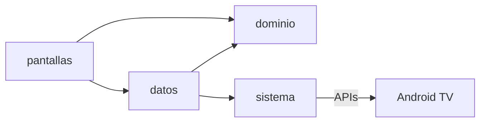
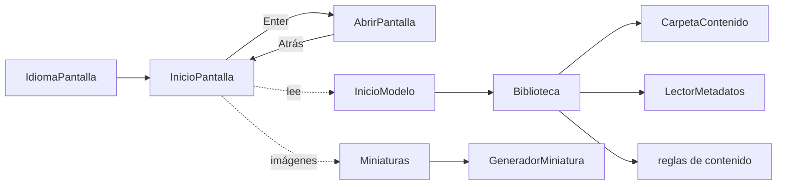
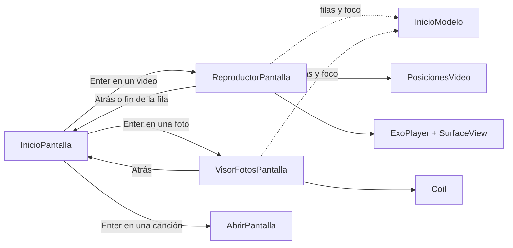
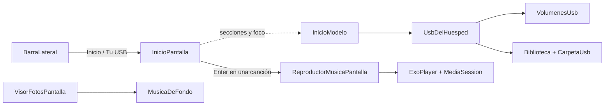

# Arquitectura

La app de TV reproduce siempre desde la memoria de la TV; en la Fase 2 la nube solo decide qué
debe tener cada TV y se lo hace descargar.

| Capa | Paquete | Para qué |
|---|---|---|
| `app/` | `pe.inkaterra.tv.app` | Arranque, tema, navegación e idioma |
| `dominio/` | `pe.inkaterra.tv.dominio` | Kotlin puro, sin Android: reglas de contenido, inactividad, campañas |
| `datos/` | `pe.inkaterra.tv.datos` | Biblioteca local, ajustes y, en la Fase 2, red y sincronización |
| `sistema/` | `pe.inkaterra.tv.sistema` | Lo que toca Android TV: decodificadores, USB, protector de pantalla, arranque |
| `pantallas/` | `pe.inkaterra.tv.pantallas` | Lo que ve el huésped (Compose for TV); no toca archivos ni red |

- `dominio/` no importa Android: se prueba en la PC.
- Lo que toca el sistema va detrás de una interfaz con un doble para las pruebas.

## Navegación, biblioteca y miniaturas (sprint 1)

- `MainActivity` arma un `Contenedor` (sin Hilt) con la biblioteca, las miniaturas y el ajuste
  de idioma, y se los pasa a `Navegacion`. Las pruebas pasan dobles en su lugar.
- **Biblioteca** (`datos/biblioteca/`): lee `getExternalFilesDir("contenido")`, clasifica por
  extensión, valida cada video con las reglas de contenido y aparta lo de `promociones/` como
  destacados. Un archivo ilegible va a «rechazados» y no corta la carga.
- **Miniaturas** (`datos/miniaturas/`): un JPEG de 1280 × 720 por archivo en
  `cacheDir/miniaturas/`, con la ruta, el tamaño y la fecha como clave; se generan de a dos.
- **Inicio** (`pantallas/inicio/`): área destacada y filas (D-20). `InicioModelo` carga la
  biblioteca una vez; el foco y Atrás viven en `InicioPantalla`.
- **Idioma** (`sistema/idioma/`): idioma por app de appcompat; desde Android 13 lo guarda el
  sistema.
- `AbrirPantalla` era provisional; el sprint 3 la reemplazó por el reproductor de música.

## Video y fotos (sprint 2)

- **Rutas:** `video/{fila}/{indice}` y `fotos/{fila}/{indice}`. Cada pantalla recibe los
  videos o las fotos de su fila (en Destacados, solo los de su tipo), que lee del `InicioModelo`
  de la entrada `inicio`. Al salir le dice al modelo qué fue lo último que se vio, y el
  inicio devuelve el foco a esa tarjeta (D-21).
- **Reproductor** (`pantallas/video/`): un ExoPlayer por pantalla sobre un `SurfaceView`, la
  única superficie que mantiene el 4K sin perder cuadros. Las reglas (retomar, saltos de 10 s,
  siguiente video) son Kotlin puro en `dominio/Reproduccion.kt` y `ListaVideos.kt`. Cada video
  deja en el registro (`Reproductor`) cuántos cuadros mostró y cuántos perdió.
- **Posiciones para retomar:** `PosicionesVideo`, una sola por proceso en el `Contenedor`; nunca
  se guardan en disco.
- **Visor** (`pantallas/fotos/`): Coil reduce cada foto al tamaño de la pantalla; la
  presentación es un temporizador de 8 s que se reinicia con cada cambio.
- **Reglas de contenido:** desde el sprint 2, un video también se rechaza si la TV no tiene un
  decodificador para su perfil (`MediaCodecList`).

## Música, barra lateral y USB del huésped (sprint 3)

- **Música** (`pantallas/musica/`): un ExoPlayer con toda la fila y una `MediaSession` que vive lo
  que vive la pantalla; no hay música en segundo plano (D-22). Al pasar a segundo plano, la
  pantalla se cierra para que la tecla Play del control no la haga sonar fuera de la app.
- **Música de fondo** (`pantallas/fotos/MusicaDeFondo.kt`): otro ExoPlayer, con la fila Música del
  hotel en orden aleatorio; suena mientras la presentación avanza.
- **Barra lateral y secciones** (`pantallas/inicio/`, D-23): `InicioModelo` guarda la sección
  (Inicio o Tu USB) y la tarjeta con el foco de cada una. Al conectar la memoria pasa solo a «Tu
  USB» si el inicio está al frente (lo sabe por el ciclo de vida de la entrada `"inicio"`); al
  retirarla vuelve a Inicio. Las rutas no cambian: `deLaFila` busca en las filas del hotel y en
  las de la USB (`TipoFila.USB_*`).
- **USB del huésped** (`datos/usb/`, D-10, D-18): `UsbDelHuesped` escucha `VolumenesUsb` y lee la
  memoria con la misma `Biblioteca` y las mismas reglas, sobre `CarpetaUsb` (que salta lo oculto y
  las carpetas de sistema). Deja el resultado en un `StateFlow<EstadoUsb>`. Las miniaturas de la
  memoria viven solo en memoria (`MiniaturasEnMemoria`); al retirarla, `Contenedor` olvida sus
  posiciones, sus miniaturas y las fotos de Coil en memoria. Los permisos de medios se dan por
  adb al instalar.
- **Botones del video** (`pantallas/video/BotonesVideo.kt`): con la barra a la vista, las flechas
  y Enter son de los botones; si no, de la pantalla, como antes. A quién le toca una tecla se
  decide al apretarla y vale hasta soltarla. La pantalla atiende Atrás antes que el foco.
- **Versión optimizada:** release con R8, firmada por ahora con la clave de depuración;
  `tool/tv.sh instalar` instala esa y `tool/tv.sh instalar depuracion` la de prueba.

Pendiente: promociones (sprint 4).
