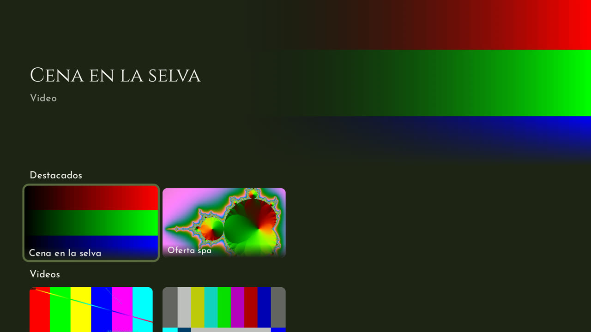
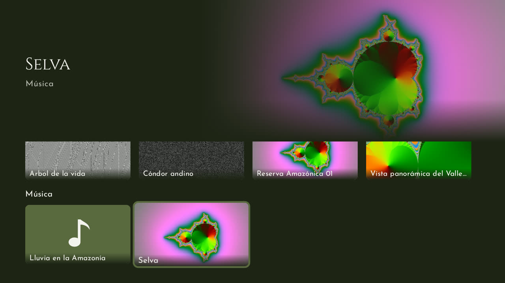
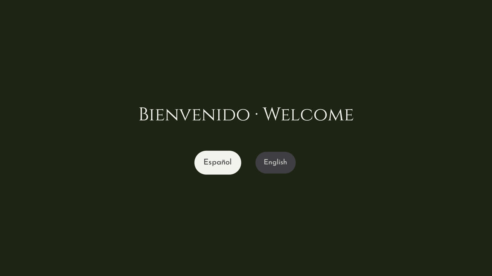

# Informe del sprint 1 — App de TV de Inkaterra

**Proyecto:** `inkaterra-tv` (Kotlin, Compose for TV, Media3) · **Rama:** `sprint-1/integracion`
(sale de `sprint-0/integracion`)
**Periodo:** 28 de octubre de 2026 (pasos 1.1 a 1.7) · **Responsable:** Adrián
**Equipo de pruebas:** Xiaomi TV Box S (Google TV, Android 14), por la red en `192.168.31.242`
**Estado:** sprint 1 completo y revisado. Falta subir la rama y abrir su PR hacia
`main` después del PR del sprint 0.

---

## 1. Resumen

El sprint 1 deja **la app navegable con el control remoto, con un inicio estilo Netflix** (D-20,
pedido a Adrián antes de empezar el sprint):

- **Inicio estilo Netflix:** arriba, un área destacada con la imagen grande, el título y el tipo
  de lo que tiene el foco; abajo, filas Destacados, Videos, Fotos y Música con la miniatura de
  cada archivo. Las filas vacías no se muestran.
- **Biblioteca del hotel:** lee la carpeta de contenido de la TV y deja afuera lo que la TV no
  puede reproducir (más de 4K, AV1, más de 60 Mbps, archivos dañados) sin cortar la carga. Lo
  de `promociones/` va a Destacados.
- **Miniaturas:** un cuadro de cada video, la foto reducida o la carátula de la canción (o la
  imagen de la marca si no tiene). Se generan una vez y quedan guardadas. En el Xiaomi, la de
  un video 4K tarda entre 1,5 y 1,8 s.
- **Control remoto:** el foco crece con borde verde; Enter abre (por ahora, una pantalla con el
  título hasta el reproductor del sprint 2); Atrás vuelve a la misma tarjeta, sube al primer
  destacado y, en la primera fila, cierra la app como cualquier app de Google TV.
- **Idioma:** la primera vez pregunta español o inglés y lo recuerda; un botón en el inicio
  ofrece el otro idioma.
- **Imagen de Inkaterra:** verde oscuro, Josefin Sans y Cinzel dentro de la app.

| Inicio | Filas con miniaturas | Primera vez |
|---|---|---|
|  |  |  |

Las capturas son del Xiaomi con contenido de muestra generado (`tool/copiar-contenido.sh`); con
las fotos y videos reales de Inkaterra se verá con sus imágenes.

---

## 2. Lo realizado, paso a paso

### Antes del sprint: inicio estilo Netflix (D-20)
- **Qué:** a Adrián le pidieron que la app fuera «estilo Netflix». Se tomó lo que Netflix hace
  en la TV y encaja en un hotel, y se dejó fuera «Seguir viendo» (privacidad entre huéspedes),
  perfiles, la ficha con descripción y el avance de video automático.
- **Commits:** `5ac5b74` (D-20 y plan de desarrollo), `c812c06` (plan del sprint 1)

### 1.1 Reglas de contenido
- **Qué:** tipo por extensión (también en mayúsculas), máximo 3840 × 2160 en cualquier
  orientación, H.264, HEVC y VP9, y hasta 60 Mbps (D-13).
- **Archivos:** `dominio/ReglasContenido.kt` · **Commit:** `cb012b3` · **Pruebas:** 12

### 1.2 Biblioteca local
- **Qué:** `CarpetaContenido`, `LectorMetadatosAndroid` (el códec sale de la pista de video, no
  del contenedor) y `Biblioteca`, que separa por tipo, aparta los destacados, ordena como en
  español («Árbol» con la A) y manda a «rechazados» lo que no cumple.
  `tool/copiar-contenido.sh` genera un juego de muestra y lo copia a la TV.
- **Commit:** `94864e1` · **Pruebas:** 8

### 1.3 Miniaturas
- **Qué:** `GeneradorMiniaturaAndroid` (cuadro al 10 % del video, foto con `ImageDecoder`,
  carátula) y `Miniaturas`, que guarda un JPEG de 1280 × 720 por archivo en la caché, de a dos
  a la vez y sin dejar archivos a medias.
- **Commit:** `223d46d` · **Pruebas:** 5 en la PC + 3 en la TV (`MiniaturasEquipoTest`)
- **Medición:** HEVC 4K 1,52 s; VP9 4K 1,79 s.

### 1.4 Tema de Inkaterra
- **Qué:** `TemaInkaterra` con los colores de la marca, Josefin Sans y Cinzel (variables, de
  Google Fonts, con su licencia OFL en `assets/licencias/`).
- **Commits:** `63b13a4`, `c474695` · **Pruebas:** 1

### 1.5 Inicio estilo Netflix
- **Qué:** `InicioPantalla`, `AreaDestacada`, `TarjetaContenido`, `Miniatura`, `InicioModelo`,
  `Navegacion` y `Contenedor`. El área destacada cambia cuando el foco lleva 500 ms quieto.
- **Commit:** `5ead557` · **Pruebas:** 10
- **Verificado en el Xiaomi:** filas, miniaturas, «…» en títulos largos, área destacada,
  Enter, Atrás a la tarjeta de origen, Atrás al primer destacado y Atrás que cierra la app.

### 1.6 Elegir el idioma
- **Qué:** `AjusteIdiomaAndroid` (idioma por app de appcompat), `IdiomaPantalla` y el botón del
  inicio.
- **Commit:** `1f7aa68` · **Pruebas:** 4 (y las 8 del inicio, adaptadas)
- **Verificado en el Xiaomi:** pregunta la primera vez, English cambia las filas a «Featured»,
  al reabrir no pregunta y desde el inicio se vuelve a español.

### 1.7 Prueba integral en el Xiaomi
- **Qué:** `FlujoSprint1Test` recorre idioma, inicio, abrir y Atrás con teclas como las del
  control, con su propia carpeta de contenido. `AppArrancaTest` acepta la pantalla de idioma o
  el inicio.

---

## 3. Calidad y verificación

| Chequeo (igual que el CI) | Resultado |
|---|---|
| Formato (`ktlintCheck`) | ✅ Sin problemas |
| Análisis (`lintDebug`, avisos como errores) | ✅ Sin problemas |
| Pruebas en la PC (`testDebugUnitTest`) | ✅ 49 de 49 |
| APK (`assembleDebug`) | ✅ |
| Pruebas en el Xiaomi (`tool/tv.sh probar`) | ✅ 9 de 9 (`VolumenesUsbTest` excluida, sin USB); 4K sigue en 0 cuadros perdidos |
| CI en GitHub | ⏳ Al subir la rama |
| Revisión final de la rama (revisor aparte) | ✅ 0 críticos · 2 importantes corregidos · 7 menores anotados |

Forma de trabajo en cada paso: rama propia → prueba primero → código → chequeos del CI → prueba
en la TV → commit → unión a `sprint-1/integracion`.

---

## 4. Decisiones tomadas

| Decisión | Motivo |
|---|---|
| D-20: inicio estilo Netflix, sin pantallas de sección | Pedido a Adrián; se dejó fuera lo que no encaja en un hotel |
| Destacados = la carpeta `promociones/` | Marketing carga una vez lo que se ve en la portada y en el bucle de promociones |
| Miniaturas en la caché, una por archivo y de a dos | El 4K tarda 1,5 a 1,8 s por video; de a dos no se agotan los decodificadores |
| Robolectric en Android 14 (API 34) | Con el Android más nuevo que trae, las pruebas de pantallas no arrancan; 34 es el del Xiaomi y Google TV 14 |
| Coil para mostrar las miniaturas | Caché en memoria y reducción al tamaño de la tarjeta |
| Más interlineado en Josefin Sans | Las tildes de las mayúsculas («Á») se cortaban en los títulos con «…» |

---

## 5. Problemas encontrados y cómo se resolvieron

| Problema | Solución |
|---|---|
| Robolectric no arrancaba con los recursos de la app (Android más nuevo, Java 21, Espresso) | Fijado en Android 14 con `robolectric.properties` |
| Lint rechazó la imagen sin carátula en el paso del tema (sin uso y de más de 200 dp) | Se agregó en el paso del inicio, con 160 × 90 dp |
| `adb push` fallaba a veces al crear subcarpetas en `Android/data` | `tool/copiar-contenido.sh` las crea antes con `mkdir -p` |
| Un video de muestra no tenía miniatura: ffmpeg lo hizo en H.264 4:4:4 | El script genera en `yuv420p`; ver el pendiente de abajo |
| La tilde de «Árbol» se cortaba en la tarjeta | Interlineado 1,6 sin recorte en los estilos de Josefin Sans |
| En las pruebas de la PC, `Key.Back` no llegaba a la actividad | Se usa el despachador de Atrás de la actividad, como la tecla real |
| `FlujoSprint1Test` no lograba borrar el idioma | Desde Android 13 se borra con el `LocaleManager` del sistema |
| Revisión: la misma miniatura se podía generar dos veces a la vez (y quedar en verde) | Un candado por archivo y una sola instancia de `Miniaturas` por proceso |
| Revisión: durante el fundido de 700 ms, un Enter de más abría dos veces | Sin fundido entre pantallas, y el inicio solo abre si es la pantalla activa |

---

## 6. Pendientes y riesgos

- **Mostrar el inicio a quien pidió el estilo Netflix** y confirmarlo (D-20).
- **H.264 4:4:4:** las reglas de contenido lo aceptan, pero la TV no lo decodifica. El sprint 2
  debe rechazarlo (mirando el perfil del video) o avisarlo al reproducir.
- **Contenido real:** las capturas usan muestras generadas; faltan fotos y videos de Inkaterra.
- **PR del sprint 0** sin abrir (falta iniciar sesión en `gh`); el del sprint 1 va después.
- Los mismos del sprint 0: memoria USB (D-18), pantalla principal (D-14) y la TCL del piloto.
- **Menores de la revisión, para más adelante:** el área destacada muestra un instante la imagen
  anterior; las canciones sin carátula vuelven a pasar por el generador; pantalla oscura sin
  aviso mientras carga la biblioteca; las filas pierden su desplazamiento al volver; los videos
  verticales se ven borrosos en el área destacada; «Tour 10» se ordena antes que «Tour 2»; los
  cambios en la carpeta con la app abierta no se ven hasta reabrirla.

---

## 7. Próximos pasos — Sprint 2: video y fotos

- Reproductor de video con Media3 (pausar, adelantar, retroceder, retomar donde quedó) en lugar
  de la pantalla provisional.
- Visor de fotos y presentación automática.
- Archivos que no se pueden reproducir: mensaje claro y se saltan (incluido H.264 4:4:4).

---

## 8. Cómo probarlo

```bash
tool/tv.sh conectar
tool/copiar-contenido.sh                               # contenido de muestra (necesita ffmpeg)
tool/tv.sh instalar
(cd apps/tv && ./gradlew ktlintCheck lintDebug testDebugUnitTest assembleDebug)
tool/videos-prueba.sh
EXCLUIR=pe.inkaterra.tv.sistema.VolumenesUsbTest tool/tv.sh probar
```

---

## 9. Glosario

| Término | Significado |
|---|---|
| **Área destacada** | La parte de arriba del inicio, con la imagen grande de lo que tiene el foco |
| **Miniatura** | Imagen chica de cada video, foto o canción en su tarjeta |
| **Foco** | La tarjeta o botón elegido con el control; se marca con un borde verde |
| **Robolectric** | Simula Android en la PC para probar pantallas sin la TV |
| **Idioma por app** | Idioma propio de la app, distinto del de la TV, que Android recuerda |
