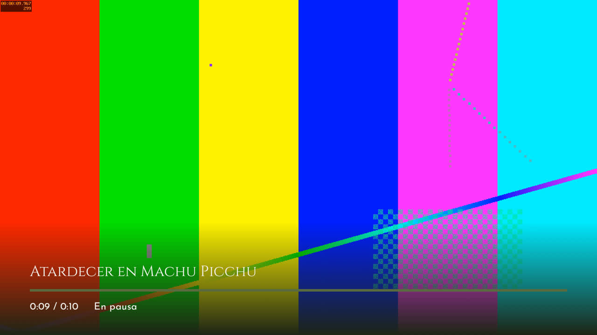
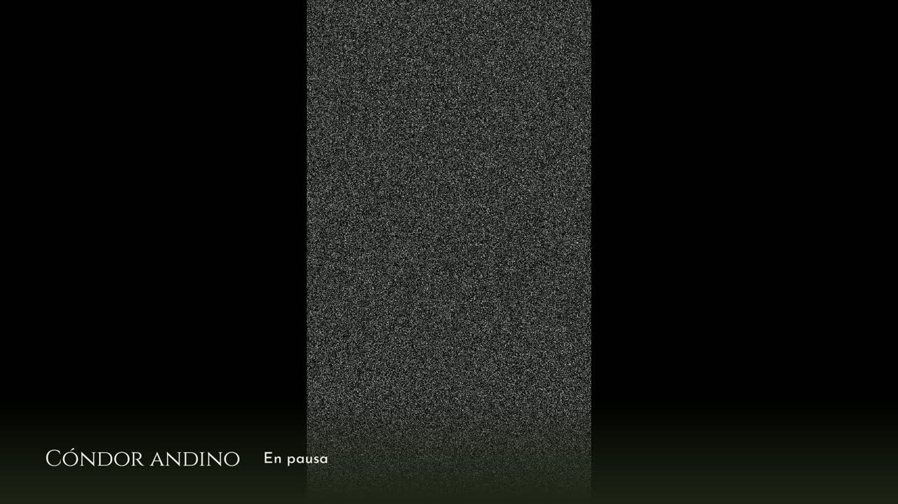
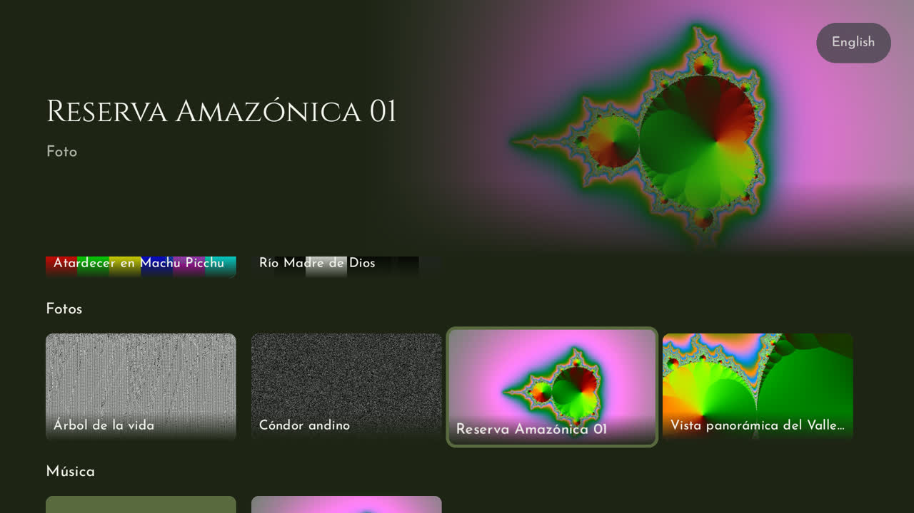

# Informe del sprint 2 — App de TV de Inkaterra

**Proyecto:** `inkaterra-tv` (Kotlin, Compose for TV, Media3) · **Rama:** `sprint-2/integracion`
(sale de `main`)
**Periodo:** 28 de octubre de 2026 (pasos 2.1 a 2.6) · **Responsable:** Adrián
**Equipo de pruebas:** Xiaomi TV Box S (Google TV, Android 14), por la red en `192.168.31.242`
**Estado:** sprint 2 completo y revisado. Falta subir la rama y abrir su PR hacia `main`.

---

## 1. Resumen

El sprint 2 hace que **los videos y las fotos se abran de verdad** (D-21):

- **Reproductor de video:** a pantalla completa y en 4K por hardware. Enter pausa y sigue;
  Izquierda y Derecha saltan 10 s sin pasar del principio ni del final. La barra con el título,
  el avance y el tiempo aparece 5 s después de cada tecla y siempre en pausa.
- **Retomar:** Atrás a mitad de un video y volver a entrar sigue donde quedó, mientras la app
  esté abierta. Si se salió en los primeros 5 s o en los últimos 15 s, empieza de cero.
- **Siguiente video:** al terminar, sigue el próximo video de la fila (saltando las fotos);
  después del último, vuelve al inicio.
- **Presentación de fotos:** arranca sola en la foto elegida, pasa cada 8 s con un fundido de
  1 s y da la vuelta. Izquierda y Derecha cambian a mano y Enter pausa.
- **Archivos malos:** un video que la TV no tiene cómo decodificar (como H.264 4:4:4) ya no
  aparece. Si igual uno falla, se ve «No se puede reproducir este video» 3 s y sigue el
  siguiente. Una foto que no abre muestra «No se puede abrir esta foto» y la presentación sigue
  a los 3 s.
- **Volver al inicio:** Atrás deja el foco en la tarjeta de lo último que se vio (el último
  video o la última foto), y las filas conservan su posición.
- **Dos arreglos del sprint 1:** las filas ya no vuelven al principio al regresar, y el área
  destacada ya no muestra un instante la imagen anterior.

| Video en pausa | Presentación de fotos | De vuelta en el inicio |
|---|---|---|
|  |  |  |

Las capturas son del Xiaomi con contenido de muestra generado (`tool/copiar-contenido.sh`). En
la del medio, una foto vertical se ve entera con bandas negras a los costados. En la de la
derecha, el foco volvió a «Reserva Amazónica 01», la última foto que se vio en la presentación.

---

## 2. Lo realizado, paso a paso

### Antes del sprint: plan y decisión D-21
- **Qué:** Adrián eligió retomar solo mientras la app esté abierta, seguir con el siguiente
  video al terminar, que la presentación arranque sola y sumar dos arreglos de la revisión del
  sprint 1.
- **Commit:** `4ddc368`

### 2.1 Videos sin decodificador
- **Qué:** la biblioteca le pregunta a la TV si tiene un decodificador para el perfil exacto de
  cada video (`MediaCodecList.findDecoderForFormat`) y deja afuera los que no. Cada rechazado
  queda en el registro con la etiqueta `Contenido`.
- **Commit:** `dfceee2` · **Pruebas:** 2 en la PC + 2 en la TV (`LectorMetadatosEquipoTest`:
  H.264 4:4:4 no se decodifica; HEVC y VP9 sí)

### 2.2 Reglas del reproductor
- **Qué:** `PosicionesVideo` (dónde retomar, en memoria), los saltos de 10 s, el texto del
  tiempo («1:05», «1:02:05») y `siguienteVideo`.
- **Commit:** `53209b8` · **Pruebas:** 9

### 2.3 Reproductor de video
- **Qué:** `ReproductorPantalla` con ExoPlayer sobre un `SurfaceView` y `BarraVideo`. Además de
  lo del plan: pausa y guarda la posición si la app pasa a segundo plano, no deja que aparezca
  el protector de pantalla y respeta la proporción de los videos que no son 16:9.
- **Commit:** `e2e3bd5` · **Pruebas:** 2

### 2.4 Visor de fotos
- **Qué:** `VisorFotosPantalla` con Coil, que reduce cada foto al tamaño de la pantalla.
- **Commits:** `348ee00`, `2ca5a02` (una prueba que fallaba a veces con la PC cargada) ·
  **Pruebas:** 7

### 2.5 Conectar al inicio
- **Qué:** rutas `video/{fila}/{indice}` y `fotos/{fila}/{indice}`; el foco del inicio vive en
  `InicioModelo` para devolverlo a lo último que se vio; las posiciones son una sola por
  proceso; y los dos arreglos del sprint 1. La música sigue en la pantalla provisional hasta el
  sprint 3.
- **Commit:** `497e044` · **Pruebas:** 5 nuevas (y 3 del sprint 1 adaptadas)
- **Verificado en el Xiaomi:** pausa con la barra, salto, paso solo al siguiente video, vuelta
  al inicio en su tarjeta, presentación que pasa sola, pausa de la presentación y vuelta a la
  última foto vista.

### 2.6 Prueba integral en el Xiaomi
- **Qué:** `FlujoSprint2Test` recorre, con teclas como las del control: ver un video 4K, pausar,
  salir y retomar, adelantar hasta que pase solo al siguiente, volver a su tarjeta, y abrir la
  presentación de fotos hasta que pase sola a la segunda.

---

## 3. Calidad y verificación

| Chequeo (igual que el CI) | Resultado |
|---|---|
| Formato (`ktlintCheck`) | ✅ Sin problemas |
| Análisis (`lintDebug`, avisos como errores) | ✅ Sin problemas |
| Pruebas en la PC (`testDebugUnitTest`) | ✅ 78 de 78 (29 nuevas) |
| APK (`assembleDebug`) | ✅ |
| Pruebas en el Xiaomi (`tool/tv.sh probar`) | ✅ 12 de 12 (`VolumenesUsbTest` excluida, sin USB) |
| Video 4K entero en la app | ✅ HEVC 4K a 40 Mbps: 750 cuadros mostrados, 0 perdidos |
| CI en GitHub | ⏳ Al subir la rama |
| Revisión final de la rama (revisor aparte) | ✅ 0 críticos · 4 importantes corregidos · 10 menores anotados |

Forma de trabajo en cada paso: rama propia → prueba primero → código → chequeos del CI → prueba
en la TV → commit → unión a `sprint-2/integracion`.

---

## 4. Decisiones tomadas

| Decisión | Motivo |
|---|---|
| D-21: retomar en memoria, seguir con el siguiente video, presentación que arranca sola | Elegido por Adrián; en un hotel, lo que vio un huésped no queda para el siguiente |
| Rechazar por el perfil, no solo por el códec | H.264 4:4:4 es «AVC» pero el Xiaomi no lo decodifica |
| La barra del video también se ve si hay error | Así se sabe qué video no se pudo reproducir |
| Pausar el video si la app pasa a segundo plano | Si no, seguía sonando después de apretar Inicio en el control |
| El foco del inicio vive en el modelo | Al volver de varios videos seguidos, el foco va al último que se vio y no al que se eligió |

---

## 5. Problemas encontrados y cómo se resolvieron

| Problema | Solución |
|---|---|
| `fotoDanadaMuestraMensajeYSigue` fallaba a veces con la PC cargada | Con el reloj automático de la prueba, los 8 s de la foto pasaban antes del error de Coil; la prueba avanza de a un cuadro mientras espera |
| En la PC, Enter con el reloj manual no llegaba en 100 ms | La prueba de la pausa aprieta Enter con el reloj automático y después avanza 9 s |
| La prueba de las filas pasaba sin el arreglo (la tarjeta 4 quedaba a la vista igual) | Se recorre hasta la sexta foto, que solo queda a la vista si la fila conservó su posición |
| Revisión: dos videos que fallaban enseguida uno tras otro podían dejar el mensaje fijo | El error guarda el índice del video que falló, así cada error vuelve a contar los 3 s |
| Revisión: en pausa, la pantalla quedaba encendida y el protector nunca aparecía | La pantalla queda encendida solo mientras el video o la presentación avanzan |
| Revisión: mantener una flecha en el visor pasaba muchas fotos y cargaba una foto entera por cada una | Una tecla mantenida cuenta una vez (también Enter en el video) |
| Revisión: ninguna prueba recorría videos que fallan | `ReproductorPantallaTest` recorre tres videos rotos hasta volver |
| La prueba del plan pausaba a los 4 s, antes del mínimo de 5 s para retomar | Pausa a los 7 s |
| En las pruebas en la TV, `Thread.sleep` no mueve el reloj de Compose | La prueba avanza el reloj de la prueba para que pasen los 8 s de la foto y para leer el tiempo |
| `hevc-60m.mp4` mide 60,6 Mbps y la regla de 60 Mbps lo rechaza | La medición se hizo con `hevc-40m.mp4`; ver el pendiente de abajo |

---

## 6. Pendientes y riesgos

- **Mirar a ojo el paso de un video a otro de distinto códec.** Al pasar de «Atardecer» (H.264
  1080p) a «Río» (HEVC 4K), la captura por adb sale negra, aunque el registro cuenta todos los
  cuadros mostrados y el compositor de la TV tiene el video en pantalla. Probablemente es un
  límite de la captura en este Amlogic, pero hay que confirmarlo mirando la TV.
- **Videos «de 60 Mbps» que miden un poco más:** un archivo codificado a 60 Mbps puede medir
  60,6 y quedar afuera (D-13). Si el hotel los va a exportar así, conviene un margen (por
  ejemplo, 62 Mbps) o pedir que se exporten a 50.
- **Menores de la revisión del sprint 2, para más adelante:** saltar en un archivo sin índice lo
  reinicia; una tecla justo al terminar un video puede saltarse el siguiente; si el panel lateral
  de Google TV está abierto cuando termina el último video, no vuelve solo al inicio; si la
  actividad se recrea, vuelve al primer video elegido; la fila enfocada se desplaza al volver;
  «En pausa» no aparece si otra app toma el audio; un video que falla a la mitad guarda esa
  posición; la miniatura muestra un cuadro de la imagen anterior; y si un archivo llega sin
  pista de video que se pueda elegir, se oye el audio sobre negro.
- **Mostrar el inicio a quien pidió el estilo Netflix** y confirmarlo (D-20).
- **Contenido real:** las capturas usan muestras generadas; faltan fotos y videos de Inkaterra.
- Los de antes: memoria USB (D-18), pantalla principal (D-14) y la TCL del piloto.
- **Menores de la revisión del sprint 1 que siguen:** las canciones sin carátula vuelven a pasar
  por el generador; pantalla oscura sin aviso mientras carga la biblioteca; videos verticales
  borrosos en el área destacada; «Tour 10» se ordena antes que «Tour 2»; los cambios en la
  carpeta con la app abierta no se ven hasta reabrirla.

---

## 7. Próximos pasos — Sprint 3: música y USB del huésped

- Reproductor de música en lugar de la pantalla provisional.
- La fila «Tu USB» con lo que el huésped conecte (antes, probar una memoria USB en la TV, D-18).

---

## 8. Cómo probarlo

```bash
tool/tv.sh conectar
tool/copiar-contenido.sh                               # contenido de muestra (necesita ffmpeg)
tool/tv.sh instalar
(cd apps/tv && ./gradlew ktlintCheck lintDebug testDebugUnitTest assembleDebug)
tool/videos-prueba.sh
EXCLUIR=pe.inkaterra.tv.sistema.VolumenesUsbTest tool/tv.sh probar
```

Para ver los cuadros perdidos de cada video: `adb logcat -s Reproductor:I`.

---

## 9. Glosario

| Término | Significado |
|---|---|
| **Decodificador** | La parte de la TV que convierte el archivo de video en imagen; cada formato y perfil necesita el suyo |
| **Perfil** | Variante de un formato de video; H.264 4:4:4 es un perfil de H.264 que el Xiaomi no tiene |
| **Cuadros perdidos** | Imágenes del video que la TV no llegó a mostrar a tiempo; con 0 el video se ve fluido |
| **Retomar** | Volver a entrar a un video y que siga donde quedó |
| **SurfaceView** | La superficie de Android donde la TV dibuja el video directamente, sin pasar por la app |
