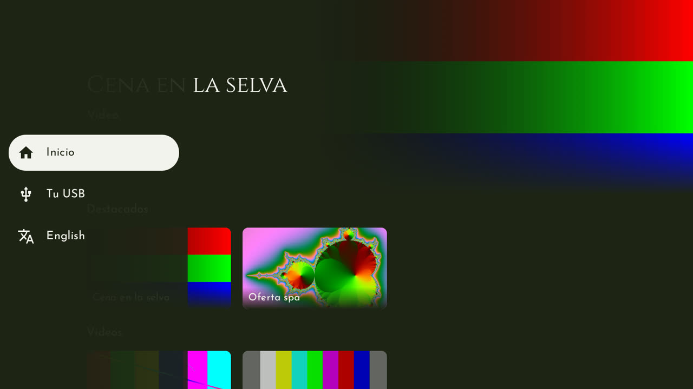
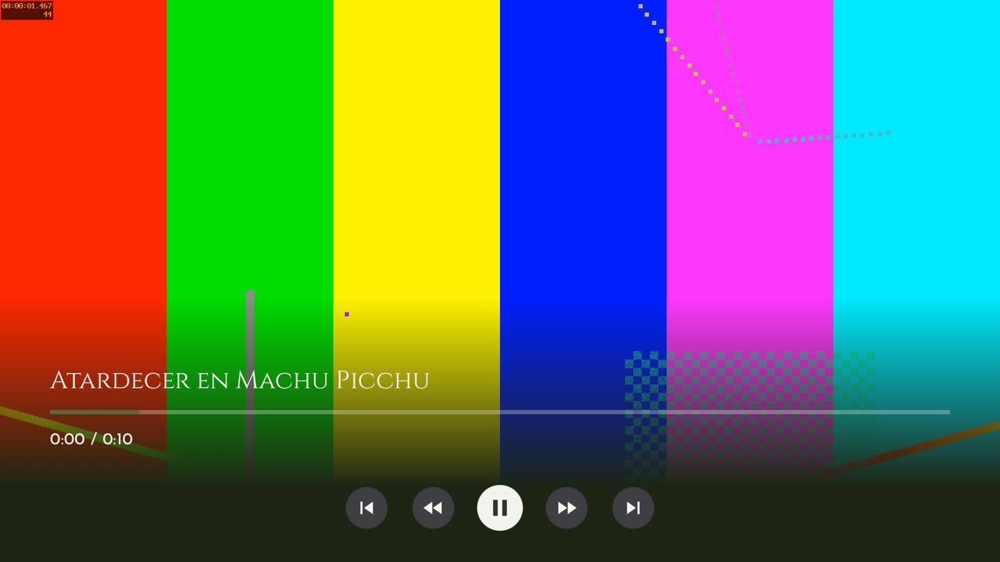
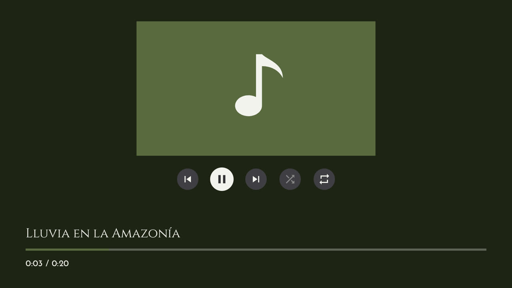

# Informe del sprint 3 — App de TV de Inkaterra

**Proyecto:** `inkaterra-tv` (Kotlin, Compose for TV, Media3) · **Rama:** `sprint-3/integracion`
(sale de `main`)
**Periodo:** 29 de octubre al 2 de noviembre de 2026 (pasos 3.0 a 3.11) · **Responsable:** Adrián
**Equipo de pruebas:** Xiaomi TV Box S (Google TV, Android 14), por la red en `192.168.31.242`
**Estado:** sprint 3 completo y revisado. Falta subir la rama y abrir su PR hacia `main`.

---

## 1. Resumen

El sprint 3 suma la **música** y la **memoria USB del huésped**, y, después de que Adrián probó la
primera parte en el Xiaomi, una **barra lateral**, **botones en el video** y la **versión
optimizada** de la app (D-22 y D-23):

- **Reproductor de música:** suena toda la fila desde la canción elegida, con botones para
  anterior, pausa, siguiente, orden aleatorio y repetir (la lista por omisión, una canción o sin
  repetir). Las teclas de música del control también funcionan. Atrás, o salir de la app, detiene
  la música.
- **Música de fondo:** la presentación de fotos suena con la música del hotel, en orden aleatorio.
- **Barra lateral, como la de Netflix:** Inicio, Tu USB e Idioma. Izquierda desde la primera
  tarjeta la abre y Derecha vuelve a la tarjeta. Atrás en la primera fila lleva a la barra, y en
  la barra cierra la app.
- **Sección «Tu USB»:** al conectar una memoria con el inicio a la vista, la app pasa sola a esta
  sección, con filas de videos, fotos y música de la memoria, de lo más nuevo a lo más viejo. No
  copia nada; al retirarla vuelve a Inicio y olvida todo lo de la memoria. Sin memoria, pide
  conectarla.
- **Botones del video:** anterior, retroceder 10 s, pausar, adelantar 10 s y siguiente. Con la
  barra escondida, las teclas funcionan como en el sprint 2.
- **Versión optimizada:** `tool/tv.sh instalar` instala una versión con R8. En el Xiaomi arranca
  en 0,3 a 0,7 s (la de prueba, en 1,5 a 1,9 s) y casi no pierde cuadros al recorrer las filas.

| Barra lateral abierta | Video con sus botones | Reproductor de música |
|---|---|---|
|  |  |  |

Las capturas son del Xiaomi con contenido de muestra generado (`tool/copiar-contenido.sh`).
«Lluvia en la Amazonía» no trae carátula, así que se ve la imagen de la marca.

---

## 2. Lo realizado, paso a paso

### Antes del sprint: plan y decisión D-22
- **Qué:** Adrián eligió que la música se detenga al salir, repetir la lista por omisión, la fila
  Música de fondo en las fotos y la USB en una sola fila (lo último cambió después con D-23).
- **Commit:** `7206a45`

### 3.1 Lista de canciones y modos de repetir
- **Commit:** `d4221f9` · **Pruebas:** 2

### 3.2 Reproductor de música
- **Qué:** `ReproductorMusicaPantalla` con ExoPlayer y `MediaSession`, y la ruta
  `musica/{fila}/{indice}`; se borró la pantalla provisional. Si fallan todas las canciones
  seguidas, vuelve al inicio en vez de mostrar el mensaje para siempre.
- **Commits:** `e5a9680` (`media3-session` 1.11.1), `effb855` · **Pruebas:** 5

### 3.3 Música de fondo
- **Commit:** `dd68923` · **Pruebas:** 1, y en el Xiaomi: suena, se pausa con la presentación y
  sin música pasa en silencio.

### 3.4 Lectura de la USB del huésped
- **Qué:** `UsbDelHuesped` escucha las memorias y las lee con la misma biblioteca y las mismas
  reglas, sobre `CarpetaUsb`, que salta lo oculto y las carpetas de sistema (`._foto.jpg`,
  `System Volume Information`, `Android/`). Los permisos de medios se dan por adb al instalar.
- **Commit:** `a6f3572` · **Pruebas:** 8

### 3.5 Fila «Tu USB» (después, sección de la barra)
- **Qué:** las miniaturas de la memoria solo en memoria; al retirarla se olvidan sus posiciones,
  sus miniaturas y las fotos de Coil.
- **Commit:** `96168c8` · **Pruebas:** 10

### 3.6 Prueba integral y guía de la prueba a mano
- **Commit:** `e469af2` · **Pruebas en el Xiaomi:** `FlujoSprint3Test.musicaYFondo`
- **Revisión de la primera parte (revisor aparte):** 0 críticos, 4 importantes corregidos en
  `dd0400b`.

### Segunda parte: decisión D-23
- **Qué:** al probar la primera parte, Adrián notó la app lenta, que no había forma visible de
  adelantar el video y que la USB quedaba amontonada en una fila y sin su música. Pidió una barra
  lateral, «como Netflix: esto va para una empresa».
- **Commit:** `9d57e07`

### 3.7 Versión optimizada
- **Qué:** la lentitud era de la versión de depuración. Release con R8, firmada por ahora con la
  clave de depuración; `copiar-contenido.sh` abre la app antes de copiar.
- **Commit:** `fb4207d`

### 3.8 Botones del video
- **Commit:** `d6aabb6` · **Pruebas:** 5 nuevas

### 3.9 Barra lateral y sección «Tu USB»
- **Commit:** `85ca0a2` · **Pruebas:** 9 nuevas y 6 adaptadas

### 3.10 Prueba integral de la segunda parte
- **Commit:** `ba20cd7` · **Pruebas en el Xiaomi:** `FlujoSprint3Test.barraYVideo`
- **Revisión de la segunda parte (revisor aparte):** 1 crítico y 5 importantes corregidos en
  `e603f23`.

### 3.11 Prueba de la USB a mano
- **Qué:** con las dos depuraciones apagadas, una memoria FAT32 con 3 videos MP4, 7 fotos JPG y
  3 canciones MP3 se leyó en 2,6 s, sin rechazados; la app pasó sola a «Tu USB», se vio y sonó
  todo, y al retirarla volvió a Inicio (D-18).
- **Commit de la guía:** `cec4ae3`

---

## 3. Calidad y verificación

| Chequeo (igual que el CI) | Resultado |
|---|---|
| Formato (`ktlintCheck`) | ✅ Sin problemas |
| Análisis (`lintDebug`, avisos como errores) | ✅ Sin problemas |
| Pruebas en la PC (`testDebugUnitTest`) | ✅ 121 de 121 (41 nuevas) |
| APK de prueba y optimizada (`assembleDebug assembleRelease`) | ✅ |
| Pruebas en el Xiaomi (`tool/tv.sh probar`) | ✅ 14 de 14 (`VolumenesUsbTest` excluida: no hay adb con la memoria leída) |
| Fluidez en el Xiaomi (versión optimizada) | ✅ Arranque en 0,6 s; 2 % de cuadros lentos al recorrer las filas |
| Memoria USB en el Xiaomi (a mano) | ✅ FAT32 con videos, fotos y música |
| CI en GitHub | ⏳ Al subir la rama |
| Revisión de cada parte (revisor aparte) | ✅ 1 crítico y 9 importantes corregidos · 10 menores anotados |

---

## 4. Decisiones tomadas

| Decisión | Motivo |
|---|---|
| D-22: la música se detiene al salir; repetir la lista; fondo aleatorio en las fotos | Elegido por Adrián; una TV de hotel no necesita música mientras se navega |
| D-23: barra lateral, «Tu USB» como sección con su música, botones del video, versión optimizada | Pedido de Adrián al probar la primera parte |
| Permisos de medios dados por adb al instalar, nunca con un diálogo | El huésped no debe ver un pedido de permisos (D-22) |
| La pantalla de música se cierra al pasar a segundo plano | Si no, la tecla Play del control hacía sonar la música fuera de la app |
| En el video, a quién le toca una tecla se decide al apretarla | Si no, OK con la barra escondida pausaba y enseguida volvía a reproducir |
| La pantalla del video atiende Atrás antes que el foco | En la TV, el primer Atrás solo sacaba el foco de los botones |

---

## 5. Problemas encontrados y cómo se resolvieron

| Problema | Solución |
|---|---|
| El Xiaomi no veía la memoria, el disco ni un mouse | Su puerto USB solo lee con la depuración por USB y la inalámbrica apagadas (D-18); la prueba es a mano |
| El registro del Xiaomi (256 K) se pisa en un par de minutos y no se pudo agrandar | De la prueba a mano quedaron solo las últimas líneas; se completó con lo que vio Adrián |
| La app se sentía lenta | Era la versión de depuración; la optimizada arranca entre 2 y 5 veces más rápido |
| Tras desinstalar, el inicio decía que no había contenido | La carpeta creada por adb antes que la app le quedaba ilegible; ahora la crea la app |
| Atrás con el foco en los botones del video no salía | Compose usaba ese Atrás para mover el foco; la pantalla lo atiende antes |
| OK con la barra escondida pausaba y volvía a reproducir, y una flecha mantenida terminaba en «siguiente» | La tecla es de quien la recibió al apretarla, hasta soltarla |
| Arriba desde la primera fila iba a «Idioma» | Desde la primera fila, Arriba no busca la barra |
| La fila «Tu USB» podía quedar en «Leyendo…» si se cerraba la app mientras leía | Una lectura cortada se repite al volver |
| En Android 11 y 12, `tv.sh` no daba el permiso correcto | Elige el permiso según la versión de la TV |
| Las canciones de la USB no aparecían (deducido por el revisor) | Se agregó `READ_MEDIA_AUDIO`; en la prueba a mano sonaron |
| Nombres de archivos del huésped en el registro de la versión del hotel | `nombreParaRegistro()`: solo en la versión de prueba |

---

## 6. Pendientes y riesgos

- **USB:** probar exFAT, NTFS, fotos HEIC y un video de más de 4K, retirar la memoria en medio de
  una lectura larga, y todo en la TCL (D-18).
- **Clave de firma del hotel** para la versión optimizada, antes del piloto (D-23).
- **Menores de las revisiones del sprint 3, para más adelante:** Atrás en el inicio no tiene una
  prueba por el camino real de teclas; una miniatura que se generaba justo al retirar la memoria
  puede quedar en la memoria RAM; en la música, «Siguiente» durante el mensaje de error salta dos
  canciones y la pantalla no se entera de pausas que no vienen de su botón; si la fila de la USB
  aparece con el foco en el idioma, el foco baja a las tarjetas (de la primera parte); el
  `alRetirar` real no tiene prueba propia; si la memoria se cambia con la app cerrada, se muestra
  la lista vieja hasta reabrir; `copiar-contenido.sh` no reinicia la app al terminar; y la release
  firmada en otra PC no se instala encima de la de esta.
- Los de antes: mostrar el inicio a quien pidió el estilo Netflix (D-20), pantalla principal
  (D-14), la TCL del piloto y el contenido real de Inkaterra.

---

## 7. Próximos pasos — Sprint 4: promociones

- Detector de inactividad dentro de la app y bucle de promociones a los 5 minutos sin uso (CU-05).
- La TV no se suspende mientras pasan, y cualquier tecla vuelve a donde estaba el huésped.

---

## 8. Cómo probarlo

```bash
tool/tv.sh conectar
tool/copiar-contenido.sh
tool/tv.sh instalar                       # la versión optimizada
(cd apps/tv && ./gradlew ktlintCheck lintDebug testDebugUnitTest assembleDebug assembleRelease)
tool/videos-prueba.sh
EXCLUIR=pe.inkaterra.tv.sistema.VolumenesUsbTest tool/tv.sh probar
```

La USB, a mano: [docs/pruebas/usb-a-mano.md](../pruebas/usb-a-mano.md).

---

## 9. Glosario

| Término | Significado |
|---|---|
| **Barra lateral** | La columna de íconos a la izquierda (Inicio, Tu USB, Idioma) que se abre con el foco |
| **MediaSession** | Lo que le avisa a Android qué está sonando, para que las teclas de música del control lo manejen |
| **Versión optimizada** | La app compilada con R8, que la achica y la acelera; es la que se instala en las TV |
| **Depuración** | El modo que deja conectar la PC a la TV por adb; mientras está encendido, el Xiaomi no lee memorias |
