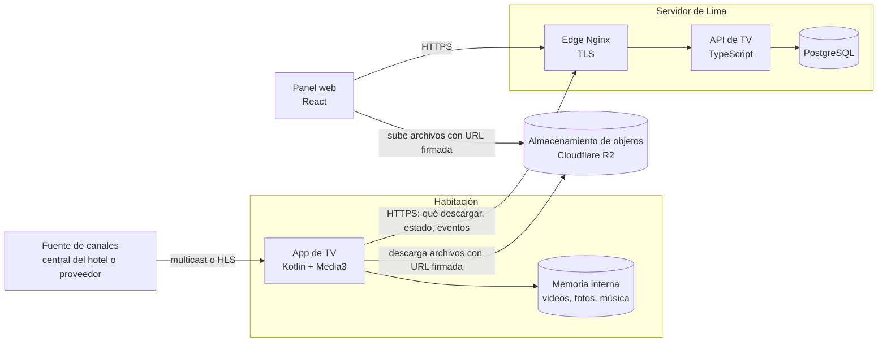
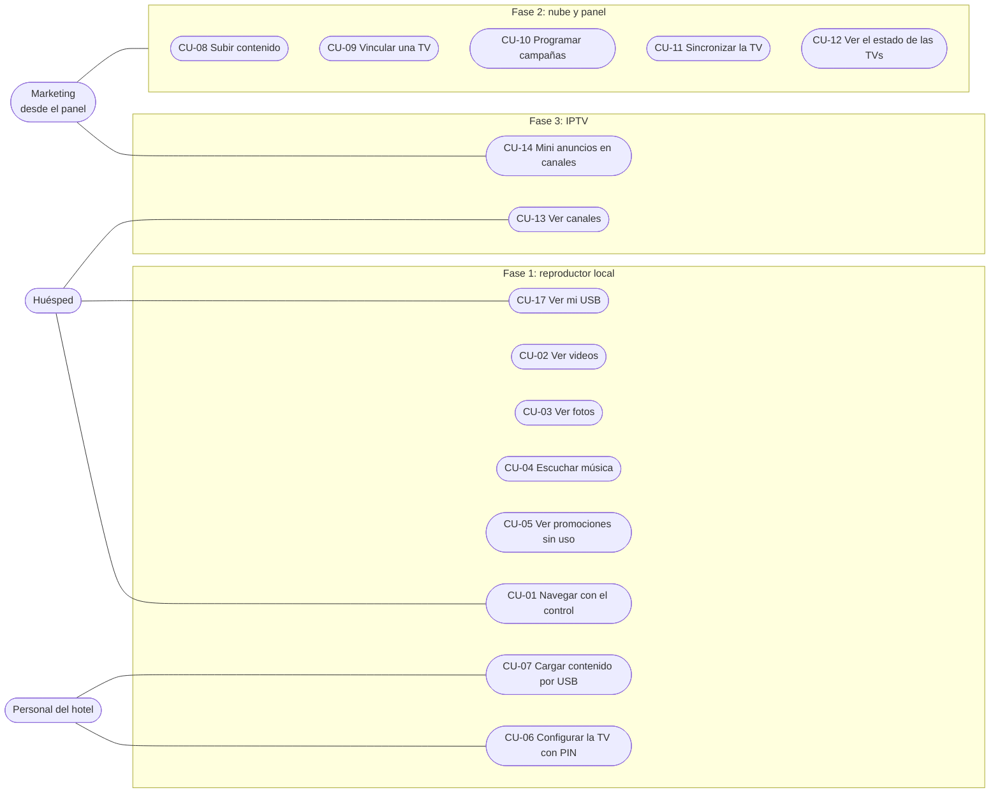
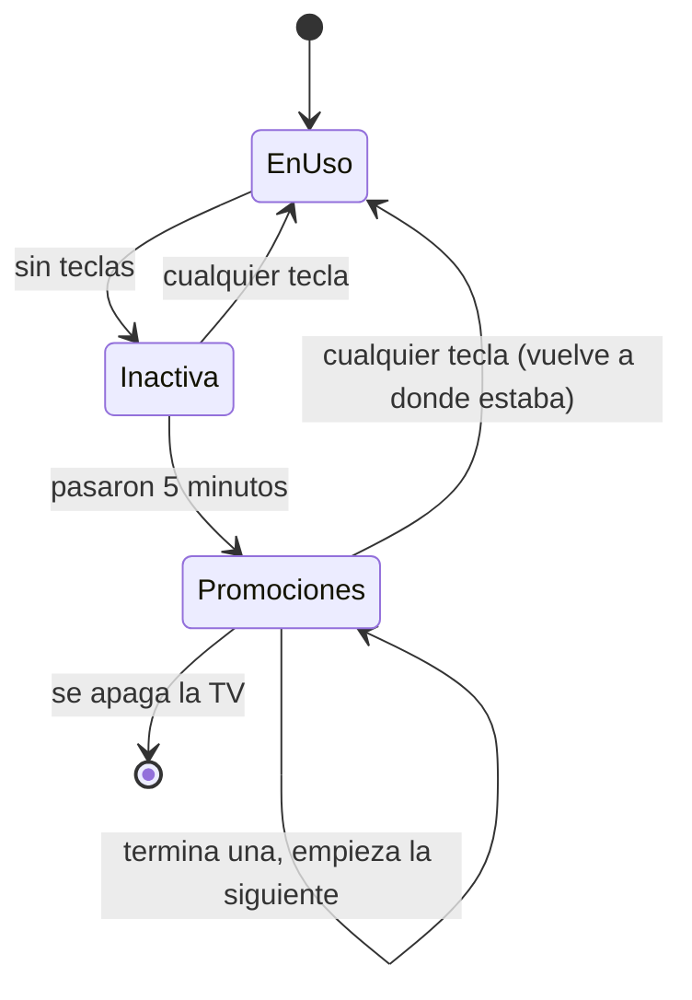
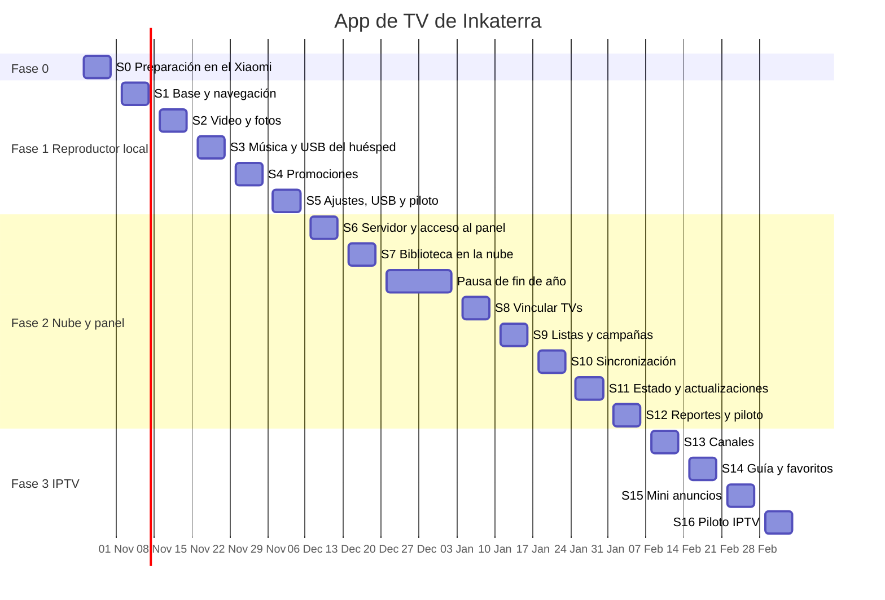

# Plan de desarrollo de la app de TV de Inkaterra

La app convierte la TV de cada habitación en la TV del hotel: el huésped ve videos, fotos y música de Inkaterra con el control remoto, y cuando nadie la usa pasan las promociones del hotel. Se construye en tres fases (reproductor local, nube con panel web e IPTV con mini anuncios), precedidas por una semana de preparación, con un sprint por semana. La desarrolla una sola persona, Adrián.

## Objetivo y alcance

Las TVs son **TCL** y están en las **habitaciones**. Hoy las habitaciones no tienen señal de TV: solo Smart TV con internet. La app es para dos tipos de persona:

- **El huésped**, que la usa con el control remoto: mira videos, fotos y música del hotel, ve **sus propias fotos y videos desde su memoria USB** (las que tomó en el viaje) y, más adelante, canales.
- **El personal del hotel** (marketing o administración), que decide qué contenido y qué promociones salen en cada TV: primero desde la propia TV con un PIN, después desde un panel web.

| Entra en el proyecto | Queda fuera |
| --- | --- |
| Reproducir videos (hasta 4K), fotos y música guardados en la TV | Apps de terceros (YouTube, Netflix): el huésped las usa desde Google TV como siempre |
| Ver las fotos y videos del huésped desde su memoria USB, sin copiarlos | Ver el celular del huésped conectado por cable (para eso Google TV ya trae Chromecast) |
| Promociones automáticas cuando la TV queda sin uso | Contratar los canales de TV (lo decide Inkaterra; la app los reproduce) |
| Panel web para subir contenido y programar campañas | Reservas, facturación o cualquier dato del sistema del hotel (salvo la Fase 4) |
| IPTV con mini anuncios de Inkaterra | Publicación en Google Play: se instala por APK |

### Qué cambia por estar en habitaciones

- **Promociones sin fin:** cuando la TV queda sin uso, las promociones siguen en bucle hasta que el huésped presiona una tecla o apaga la TV. No hay horario de silencio, y la TV no debe apagarse sola mientras pasan.
- **La memoria USB del huésped es privada:** la app la lee sin copiar nada, y al retirarla no queda rastro (ni miniaturas ni historial).
- **Idioma:** los huéspedes son internacionales. La app está en español e inglés desde el primer sprint.
- **La TV no debe quedar «rota»:** si un archivo está dañado o falta, la app lo salta y sigue. Nadie del hotel va a estar mirando.
- **El huésped no puede cambiar nada:** los ajustes van protegidos con PIN.

## Decisiones

### Tecnología de la app de TV

Recomendamos **Kotlin con Jetpack Compose for TV y Media3 (ExoPlayer)**. Es el camino oficial de Google para Android TV, y el corazón de esta app es el video.

| Opción | A favor | En contra |
| --- | --- | --- |
| **Kotlin + Compose for TV + Media3** (recomendada) | Mejor control del video 4K: HDR, ajuste de la frecuencia de la pantalla y reproducción directa por hardware. Reproduce IPTV por multicast y HLS. Protector de pantalla, arranque al encender y modo kiosco sin capas extra. Menos memoria | Más Kotlin del que usa asistencia-movil (allí ya hay `Telefono.kt` y `ClavesHardware.kt`) |
| Flutter | Ya se conoce por asistencia-movil | El foco del control remoto se hace a mano. Su reproductor es el mismo ExoPlayer, pero con menos control. Multicast, protector de pantalla y kiosco igual requieren Kotlin: serían dos lenguajes para lo mismo |
| React Native TV | — | Soporte débil para TV y para video 4K |

Piezas principales:

- **Pantallas:** Compose for TV (`androidx.tv`), con el foco del control remoto resuelto por la librería.
- **Video y audio:** Media3 ExoPlayer (archivos locales, HLS, DASH y UDP multicast) y `MediaSession`, para que funcionen las teclas de reproducción del control.
- **Imágenes:** Coil.
- **Datos locales:** Room (biblioteca, campañas y cola de eventos) y DataStore (ajustes).
- **Tareas en segundo plano:** WorkManager (descargas y envío de eventos en la Fase 2).
- **Red (Fase 2):** OkHttp con kotlinx.serialization.
- **Pruebas:** JUnit para la lógica, pruebas de Compose para las pantallas y pruebas instrumentadas en el Xiaomi (y en la TCL desde el piloto).

### Equipos

| Equipo | Para qué | Ficha |
| --- | --- | --- |
| **Xiaomi TV Box S** (MiTV-AFMU0, de Adrián) | Desarrollo y pruebas diarias, por la red (`adb connect 192.168.31.242:5555`) | Google TV con Android 14 (SDK 34), chip Amlogic, 2 GB de RAM, **26 GB de almacenamiento con ~24 GB libres**, decodificadores por hardware H.264, HEVC, VP9 y AV1, y un puerto USB. Hoy conectado a una pantalla 1080p sin HDR. Reemplaza al onn. 4K Streaming Box que se usó al planificar, que tenía ~1 GB libre |
| **TCL de las habitaciones** (de Inkaterra) | Piloto y producción | Se asume Google TV (según Canelo). Falta el modelo, la RAM y el espacio libre |

Que algo funcione en el Xiaomi no garantiza que funcione en la TCL: tienen chips distintos. Por eso el piloto del sprint 5 se hace en una TCL. Para comprobar la **salida** 4K y HDR hace falta una pantalla 4K; con la pantalla 1080p actual solo se comprueba que el Xiaomi **decodifica** el 4K.

### Imagen de marca

Todo se toma de la web de Inkaterra; Adrián se encarga de validarlo.

| Pieza | Valor | Nota |
| --- | --- | --- |
| Verde principal | `#5A6A40` | El verde oliva oscuro de la web: barras, fondos de tarjetas y foco |
| Verde secundario | `#626A45` | Detalles |
| Crema | `#F3F2EE` | Fondos claros |
| Texto | `#424242` sobre claro, blanco sobre verde | — |
| Letra del texto | **Josefin Sans** | Libre (licencia OFL); va dentro de la app |
| Letra de los títulos | La web usa **Trajan Pro**, que es de pago (Adobe) | Se usa **Cinzel**, libre y de estilo parecido, salvo que Inkaterra tenga la licencia de Trajan para apps |
| Logo, fotos y videos de muestra | Los de la web | Solo para desarrollo y pruebas. Los archivos pesados no se suben al repositorio |

En la TV se usa sobre todo el **fondo oscuro con verde**: en una habitación con poca luz, una pantalla blanca encandila.

### Tecnología del panel y del servidor (Fase 2)

- **Panel web:** TypeScript con React, Vite y Tailwind, igual que la web de asistencia-vip.
- **API:** TypeScript (Node con Hono o Fastify) y PostgreSQL.
- **Despliegue:** en el **servidor de Lima** que ya usa asistencia, como un servicio más.
- **Archivos (videos, fotos, música):** en un **almacenamiento de objetos** (Cloudflare R2 recomendado: no cobra por descarga), no en el disco del servidor.

Se escoge TypeScript para el servidor, y no Rust como core-api, porque la app la mantiene una sola persona: un solo lenguaje para el panel y la API es más rápido de desarrollar y revisar. Se reutiliza todo lo de operación que ya armó Rubén: Docker, el edge de Nginx, GHCR, los respaldos y el monitoreo.

### El servidor que ya existe

Asistencia vive en **`ubuntu-server-lima-ts`** (fuente: `asistencia-vip/docs/despliegue-lima.md`, copia local del 16 de octubre):

- Ubuntu 24.04, con todo en **Docker Compose**; las imágenes se publican en GHCR.
- Un **edge de Nginx compartido** (TLS con Let's Encrypt) toma los puertos 80 y 443 y reparte por dominio: `inventory.inkaterra.pe`, `asistencia.inkaterra.pe` y fe-engine.
- Asistencia: core-api (Rust/Axum), vision-engine (Python), PostgreSQL 16, Redis y la web (React 19).
- Ambiente de pruebas aparte, que se actualiza solo desde `main` (`pruebas.177-91-250-28.sslip.io`).
- **Límites:** la máquina tenía 2 vCPU, 2,8 GB de RAM y unos 16 GB de disco libre. Por eso los archivos de la TV no pueden vivir ahí: un video 4K de 10 minutos pesa entre 1 y 3 GB.

La app de TV agregaría un dominio más al edge (por ejemplo `tv.inkaterra.pe`) con su propio contenedor y su base. Se coordina con Rubén antes de la Fase 2.

### Decisiones tomadas

| Código | Decisión | Motivo |
| --- | --- | --- |
| D-01 | App de TV en Kotlin con Compose for TV y Media3 | Es la opción con mejor rendimiento de video y la que da acceso directo al sistema |
| D-02 | Siempre se reproduce desde la memoria interna de la TV, también en la Fase 2 | Las sedes remotas (Amazonía, Machu Picchu, Cabo Blanco) tienen internet débil; la nube solo sincroniza |
| D-03 | Máximo 4K (3840 × 2160). Se valida al importar (Fase 1) y al subir (Fase 2) | Ningún archivo que la TV no pueda reproducir llega a la TV |
| D-04 | Instalación por APK, sin Google Play | Son TVs del hotel; en la Fase 2 la app se actualiza desde el panel |
| D-05 | La app no depende de la fuente de IPTV: recibe una lista de canales con su dirección | El hotel puede cambiar de proveedor o usar uno distinto por sede sin cambiar la app |
| D-06 | Panel y API en TypeScript, desplegados en el servidor de Lima | Un solo lenguaje para una sola persona; se reutiliza la operación de asistencia |
| D-07 | Archivos en almacenamiento de objetos (Cloudflare R2) | El disco del servidor no alcanza y R2 no cobra la descarga de cada TV |
| D-08 | Un solo repositorio privado, `adriian1020/inkaterra-tv`, para la app, el panel y la API (`apps/tv`, `apps/panel`, `services/api`) | Una sola persona: un lugar para el contrato, la documentación y el CI |
| D-09 | Sin horario de silencio: las promociones siguen hasta una tecla o hasta apagar la TV | Pedido del proyecto. Los anuncios dentro de los canales se definen en la Fase 3 |
| D-10 | La USB del huésped se lee sin copiar nada y sin guardar rastro | Son fotos personales; el próximo huésped no debe ver nada |
| D-11 | El mismo contenido del hotel en todas las TVs (Fase 1) | Pedido del proyecto. La Fase 2 permite separar por hotel si hace falta |
| D-12 | Marca tomada de la web: verde `#5A6A40`, Josefin Sans y Cinzel en lugar de Trajan Pro | Trajan Pro es de pago; Cinzel es libre y parecida |

### Decisiones pendientes

Ya cerradas para la Fase 0: equipo de desarrollo (Xiaomi), TCL con Google TV (supuesto), Product Owner (Adrián) y marca (la web).

Antes del sprint 4 (lunes 23 de noviembre):

- [ ]  **Información del hotel:** si la Fase 1 lleva una pantalla «Información» con textos fijos (restaurante, spa, excursiones, wifi, hora de salida) o si se deja para cuando el panel pueda editarla (ver Fase 4)

Antes del sprint 5 (lunes 30 de noviembre):

- [ ]  **¿La app es la pantalla principal de la TV o una app más de Google TV?** El sprint 0 averigua qué permite Google TV; con eso se decide. Mientras tanto, la app se construye como una app normal, que sirve para los dos casos
- [ ]  Modelo y espacio libre de la TCL, y tener una disponible para el piloto
- [ ]  Música: si Inkaterra tiene música con licencia para usar en el hotel, o se usa música libre de derechos

Antes de la Fase 2 (lunes 7 de diciembre):

- [ ]  Espacio en el servidor de Lima y dominio (`tv.inkaterra.pe`), con Rubén y TI
- [ ]  Cuenta de almacenamiento de objetos y presupuesto mensual
- [ ]  Velocidad de internet de cada sede
- [ ]  Cuántas TVs hay por hotel

Antes de la Fase 3 (lunes 8 de febrero):

- [ ]  Fuente de los canales y sus licencias (ver Fase 3)
- [ ]  Si la red de cada hotel soporta multicast (IGMP), en caso de usar una central de TV

## Arquitectura

La TV nunca depende de internet para reproducir: todo lo que muestra está en su memoria. La nube solo decide **qué** debe tener cada TV y se lo hace descargar.



En la Fase 1 solo existe la caja «Habitación»; el resto llega con las fases 2 y 3.

### Capas de la app de TV

Las mismas ideas de asistencia-movil, en Kotlin:

```
app/         Arranque, tema Inkaterra, navegación e idioma
dominio/     Kotlin puro y probado: reglas de contenido (4K, formatos), inactividad,
             campañas, reintentos
datos/       Biblioteca local (Room), archivos, ajustes, y en la Fase 2: red y sincronización
sistema/     Lo que toca Android TV: protector de pantalla, arranque al encender, kiosco,
             USB, instalación de actualizaciones
pantallas/   Lo que ve el huésped (Compose for TV); no tocan archivos ni red directamente
```

- `dominio/` no importa Android: se prueba con pruebas unitarias simples, en la PC.
- Todo lo que toca el sistema (archivos, USB, reproductor, ajustes) va detrás de una interfaz con un doble para las pruebas, como `AlmacenSeguro` y `AlmacenSeguroEnMemoria` en asistencia-movil.

### Estructura del repositorio

Repositorio privado `adriian1020/inkaterra-tv`, ordenado como asistencia-movil:

```
README.md                Qué es, cómo arrancar y enlaces a docs/
CHANGELOG.md             Keep a Changelog + SemVer, sección «Sin publicar»
docs/
  plan-de-desarrollo.md  Este documento
  desarrollo.md          Entorno, comandos, pruebas y convenciones
  arquitectura.md        Capas y flujos, con diagramas
  decisiones.md          D-01… y lo que se averigüe de Google TV
  informes/              Un informe por sprint (sprint-0.md, sprint-1.md…)
  planes/                Los pasos de cada sprint (sprint-0.md, sprint-1.md…)
apps/tv/                 App de Android TV (Gradle)
  app/src/main/java/pe/inkaterra/tv/
    app/ dominio/ datos/ sistema/ pantallas/
  app/src/test/          Pruebas unitarias y de pantallas: espejo de main/
  app/src/androidTest/   Pruebas en el Xiaomi (equivalen a integration_test/)
apps/panel/              Panel web (desde la Fase 2)
services/api/            API (desde la Fase 2)
tool/                    Scripts (por ejemplo, instalar en el Xiaomi por la red)
.github/workflows/       CI por carpeta: la app de TV, el panel y la API
```

Los videos y fotos de muestra no se versionan: viven en una carpeta local ignorada por git y se copian al Xiaomi con un script de `tool/`.

## Casos de uso



| Código | Caso de uso | Actor | Fase |
| --- | --- | --- | --- |
| CU-01 | Navegar el inicio con el control remoto, en español o inglés | Huésped | 1 |
| CU-02 | Ver videos (hasta 4K) | Huésped | 1 |
| CU-03 | Ver fotos en presentación, con música de fondo | Huésped | 1 |
| CU-04 | Escuchar música | Huésped | 1 |
| CU-05 | Ver promociones cuando la TV queda sin uso | Huésped (pasivo) | 1 |
| CU-06 | Configurar la TV con PIN (tiempo de espera, nombre de la habitación, idioma) | Personal | 1 |
| CU-07 | Cargar el contenido del hotel desde una memoria USB | Personal | 1 |
| CU-17 | Ver mis fotos y videos desde mi memoria USB | Huésped | 1 |
| CU-08 | Subir videos, fotos, música y promociones | Marketing | 2 |
| CU-09 | Vincular una TV a un hotel y habitación | Marketing o TI | 2 |
| CU-10 | Programar campañas por fecha, hora y TVs | Marketing | 2 |
| CU-11 | Sincronizar el contenido de la TV | La TV, sola | 2 |
| CU-12 | Ver el estado de cada TV, cambiar su configuración y actualizar la app | Marketing o TI | 2 |
| CU-13 | Ver canales de TV | Huésped | 3 |
| CU-14 | Ver mini anuncios de Inkaterra mientras se ven canales | Huésped (pasivo) | 3 |
| CU-15 | Bienvenida con el nombre del huésped | Huésped | 4 (opcional) |
| CU-16 | Información del hotel: restaurante, spa, excursiones | Huésped | 4 (opcional), o 1 si se decide así |

CU-17 se agregó después de numerar los demás; los códigos no se reordenan para no romper las referencias.

### CU-05 Ver promociones cuando la TV queda sin uso

**Actor:** huésped (pasivo). **Antes:** hay al menos una promoción cargada.

1. El huésped deja de usar el control durante el tiempo configurado (por ejemplo, 5 minutos).
2. La app empieza a pasar las promociones en bucle, sin fin: imágenes con su duración y videos completos.
3. El huésped presiona cualquier tecla: las promociones se detienen y vuelve exactamente a donde estaba.
4. Si nadie presiona nada, siguen hasta que se apague la TV. Mientras pasan, la TV no se apaga ni se suspende sola.

**Variantes:**

- 1a. El huésped está en otra app (YouTube, por ejemplo): las promociones salen como **protector de pantalla del sistema**, si la TCL lo permite (se verifica en la Fase 0).
- 1b. El huésped está viendo un video: no se interrumpe; la espera empieza al terminar.
- 1c. El huésped está mirando las fotos de su USB: se trata igual que un video; la espera empieza cuando deja la presentación.
- 2a. Una promoción está dañada: se salta y queda en el registro de errores.
- 2b. No hay promociones cargadas: la TV se queda en el inicio.



### CU-17 Ver mis fotos y videos desde mi memoria USB

**Actor:** huésped. **Antes:** ninguno.

1. El huésped conecta su memoria USB (o un lector con la tarjeta de su cámara).
2. La app lo detecta y ofrece «Ver mis fotos y videos».
3. El huésped recorre sus carpetas, mira las fotos en presentación y reproduce sus videos.
4. Al retirar la USB, la app vuelve al inicio y no queda nada guardado.

**Variantes:**

- 1a. La USB tiene un formato que la TV no lee (por ejemplo NTFS): la app lo dice en palabras simples.
- 3a. Un archivo no se puede abrir (formato raro o dañado): se salta con un aviso, sin cerrar la presentación.
- 3b. El video pasa de 4K: se avisa que no se puede reproducir en esta TV.

### CU-11 Sincronizar la TV

**Actor:** la TV, sin intervención. **Antes:** la TV está vinculada (CU-09).

1. Cada cierto tiempo la TV pregunta a la API qué contenido y qué campañas le tocan (el **manifiesto**).
2. Compara con lo que tiene y descarga solo lo que falta, directamente del almacenamiento, con una URL firmada.
3. Verifica cada archivo con su huella (SHA-256) y recién entonces lo da por disponible.
4. Borra lo que ya no le toca, si no se está reproduciendo.
5. Informa a la API qué tiene, cuánto espacio le queda y su versión.

**Variantes:**

- 2a. Sin internet: sigue reproduciendo lo que tiene y reintenta más tarde.
- 2b. Archivos grandes: se descargan de noche y se retoman si se corta la conexión.
- 2c. No hay espacio: descarga primero lo de mayor prioridad (campañas vigentes) y avisa en el panel.

## Reglas de contenido

| Tipo | Formatos | Límites |
| --- | --- | --- |
| Video | MP4 o MKV con H.264 o H.265 (HEVC) | Hasta 3840 × 2160 (4K). La tasa de datos máxima se fija en la Fase 0 según lo que reproduzca fluido la TCL |
| Foto | JPG, PNG o WebP | Si pasa de 4K, se reduce al mostrarla |
| Música | MP3, AAC (M4A) o FLAC | — |
| Promoción | Un video o una foto con su duración en pantalla | Mismas reglas que video y foto |

Un archivo que no cumple se rechaza con un mensaje claro («El video mide 7680 × 4320; el máximo es 4K»), nunca en silencio.

**USB del huésped:** además se aceptan los formatos de los celulares y cámaras: fotos **HEIC** y videos **MOV** (H.264 o HEVC). La memoria puede venir en FAT32 o exFAT; NTFS depende de la TV (se comprueba en la Fase 0).

## Fases y sprints



| Fase | Sprints | Fechas | Se acepta cuando |
| --- | --- | --- | --- |
| 0. Preparación | 1 | 26 al 30 oct | Un video 4K se reproduce fluido en el Xiaomi y se sabe qué permite Google TV (pantalla principal, protector de pantalla, USB) |
| 1. Reproductor local | 5 | 2 nov al 4 dic | Una TV funciona varios días en una habitación real sin que nadie la toque |
| 2. Nube y panel | 7 | 7 dic al 5 feb (con pausa de fin de año) | Marketing administra el contenido de un hotel durante una semana sin ayuda |
| 3. IPTV con mini anuncios | 4 | 8 feb al 5 mar | Varias habitaciones ven canales con mini anuncios durante una semana |
| **Total** | **17** | **19 semanas** (17 sprints y 2 de pausa) | |
| 4. Bienvenida e información (opcional) | 3 | 8 al 26 mar | — |

### Calendario por semana

| Semana | Sprint | Fechas | Objetivo | Se acepta cuando |
| --- | --- | --- | --- | --- |
| 1 | S0 Preparación | 26 al 30 oct | Ficha del Xiaomi, prueba de 4K, límites de Google TV, repositorio y CI | Una app mínima del CI reproduce 4K en el Xiaomi y hay un informe de lo que permite Google TV |
| 2 | S1 Base y navegación | 2 al 6 nov | Tema Inkaterra, inicio, control remoto, idioma y biblioteca local | Se recorre todo el inicio con el control y se listan los archivos |
| 3 | S2 Video y fotos | 9 al 13 nov | Reproductor de video 4K y presentación de fotos | Video 4K completo y presentación sin trabas en el Xiaomi |
| 4 | S3 Música y USB del huésped | 16 al 20 nov | Música con teclas del control, fotos con música, USB del huésped | Suena una lista, y una USB de celular se ve y no deja rastro |
| 5 | S4 Promociones | 23 al 27 nov | Promociones sin fin a los 5 minutos sin uso | Siguen horas sin que la TV se suspenda y una tecla devuelve al huésped |
| 6 | S5 Ajustes, USB del hotel y piloto | 30 nov al 4 dic | PIN, cargar contenido por USB, arranque y piloto en una TCL | La TCL del piloto funciona varios días sin intervención |
| 7 | S6 Servidor y acceso al panel | 7 al 11 dic | API, base de datos, despliegue en pruebas e inicio de sesión del panel | Un administrador entra al panel en pruebas |
| 8 | S7 Biblioteca en la nube | 14 al 18 dic | Subir archivos grandes, validar 4K, miniaturas | Se sube un 4K y se rechaza uno de más de 4K |
| 9 y 10 | Pausa | 21 dic al 1 ene | Fin de año; colchón si algo se atrasó | — |
| 11 | S8 Vincular TVs | 4 al 8 ene | Hoteles, habitaciones y vinculación con código | Una TV queda vinculada a una habitación desde el panel |
| 12 | S9 Listas y campañas | 11 al 15 ene | Listas y campañas con fechas, horario y destino | Una campaña llega solo a las TVs elegidas |
| 13 | S10 Sincronización | 18 al 22 ene | Manifiesto, descargas que se retoman y modo sin internet | Una promoción subida aparece sola en la TV, y sin internet todo sigue |
| 14 | S11 Estado y actualizaciones | 25 al 29 ene | Estado de cada TV, configuración y actualización a distancia | El panel ve una TV caída e instala una versión nueva |
| 15 | S12 Reportes y piloto | 1 al 5 feb | Conteo de reproducciones, registro de cambios, manual y piloto | Marketing maneja un hotel una semana sin ayuda |
| 16 | S13 Canales | 8 al 12 feb | Canales en el panel y reproducción HLS y multicast | Se cambia de canal con el control en pocos segundos |
| 17 | S14 Guía y favoritos | 15 al 19 feb | Guía de programación y favoritos | La guía muestra qué se emite ahora y después |
| 18 | S15 Mini anuncios | 22 al 26 feb | Anuncios en franja, marco en L o esquina, programados desde el panel | Salen según la campaña sin tapar el canal más de lo permitido |
| 19 | S16 Piloto IPTV | 1 al 5 mar | Fuente real en un hotel y prueba con varias habitaciones | Varias habitaciones ven canales con anuncios una semana |
| 20 a 22 | S17 a S19 (opcional) | 8 al 26 mar | Fase 4: bienvenida, información del hotel y limpieza al salir | Se decide al terminar la Fase 3 |

El inicio supuesto es el lunes 26 de octubre. Adrián trabaja este proyecto **al mismo tiempo que asistencia-movil**; los sprints se planifican de una semana, y si uno termina antes, el siguiente se adelanta. Cada sprint termina con una prueba en el Xiaomi (y en la TCL desde el piloto), y si no se cumple, el siguiente no empieza.

### Fase 0. Preparación

**Sprint 0: preparación en el Xiaomi (26 al 30 oct)**

El objetivo es no construir sobre supuestos. Todo lo que depende de la TV se prueba primero, en el Xiaomi.

- Ficha completa del Xiaomi: códecs de video que decodifica por hardware (H.264, HEVC, VP9, AV1) y hasta qué resolución y tasa de datos.
- **Prueba de 4K:** reproducir con Media3 videos 4K en H.264 y HEVC a distintas tasas de datos, y medir si se pierden cuadros. De aquí sale el límite de la tabla de reglas de contenido.
- **Pruebas de lo que permite Google TV 14**, porque limita cosas que esta app necesita:
  - ser la pantalla principal de la TV (para decidir antes del sprint 5);
  - abrir la app sola al encender la TV;
  - usar la app como protector de pantalla del sistema (hoy el Xiaomi no tiene ninguno configurado);
  - que la TV no se suspenda mientras pasan las promociones (hoy se suspende a los 20 minutos);
  - leer una memoria USB en FAT32, exFAT y NTFS, y enterarse de cuándo se conecta y se retira.
- **Espacio:** el Xiaomi tiene ~24 GB libres, pero la TCL no se sabe. Medir cuánto ocupa el contenido de muestra y qué hace Android al llenarse.
- Repositorio `inkaterra-tv` con la estructura de carpetas, Gradle, el CI (formato, análisis, pruebas y APK) y `docs/`.
- Convenciones copiadas de asistencia: todo en español, commits `tipo(ámbito): resumen`, ramas por paso, CHANGELOG y SemVer.

**Se acepta cuando:** una app mínima generada por el CI se instala en el Xiaomi por la red y reproduce un video 4K sin perder cuadros, y un informe dice qué se puede y qué no en Google TV.

### Fase 1. Reproductor local (5 sprints)

**Sprint 1: base y navegación (2 al 6 nov)**

- Tema de Inkaterra (ver «Imagen de marca»): verde `#5A6A40`, Josefin Sans y Cinzel dentro de la app, y el logo.
- Pantalla de inicio para TV, con secciones Videos, Fotos y Música («Información» solo si se decide antes del sprint 4).
- Navegación completa con el control remoto: foco siempre visible y tecla Atrás coherente.
- Elegir idioma (español o inglés) y recordarlo.
- Biblioteca local: leer la carpeta de contenido de la app, clasificar por tipo y aplicar las reglas de contenido (`dominio/`).

**Se acepta cuando:** se recorre todo el inicio con el control de la TCL y se ven listados los archivos de la carpeta de contenido.

**Sprint 2: video y fotos (9 al 13 nov)**

- Reproductor de video con Media3: pausar, adelantar y retroceder con el control, retomar donde quedó y barra de información.
- Visor de fotos y presentación automática con transiciones.
- Archivos dañados o fuera de las reglas: mensaje claro, se saltan y quedan en el registro.

**Se acepta cuando:** se ve un video 4K completo y una presentación de fotos en el Xiaomi sin trabas.

**Sprint 3: música y USB del huésped (16 al 20 nov)**

- Reproductor de música con `MediaSession`: las teclas de reproducción del control funcionan.
- Listas, repetir y orden aleatorio.
- Presentación de fotos con música de fondo.
- **USB del huésped** (CU-17): detectar cuándo se conecta y se retira, recorrer sus carpetas y ver fotos (también HEIC) y videos con los reproductores del sprint 2, sin copiar nada.

**Se acepta cuando:** suena una lista completa, las fotos pasan con música de fondo, y una USB con fotos de celular se ve al conectarla y no deja rastro al retirarla.

**Sprint 4: promociones (23 al 27 nov)**

- Detector de inactividad dentro de la app (CU-05).
- Bucle de promociones sin fin (fotos con su duración y videos) y regreso exacto a donde estaba el huésped.
- La TV no se suspende mientras pasan las promociones.
- Protector de pantalla del sistema, si el sprint 0 confirmó que Google TV lo permite.

**Se acepta cuando:** a los 5 minutos sin uso empiezan las promociones, siguen durante horas sin que la TV se suspenda, y cualquier tecla devuelve al huésped a donde estaba.

**Sprint 5: ajustes, USB y piloto (30 nov al 4 dic)**

- Ajustes protegidos con PIN (CU-06): tiempo de espera, nombre del hotel y habitación, idioma por omisión y volumen de las promociones.
- Cargar el contenido del hotel desde USB (CU-07), validando cada archivo y mostrando el avance y el espacio libre. Se distingue de la USB del huésped porque se entra desde los ajustes con PIN.
- Arranque al encender la TV, y pantalla principal o app normal, según lo que se decida con el sprint 0.
- Registro de errores local, visible desde los ajustes.
- **Piloto:** una TCL en una habitación real durante varios días.

**Se acepta cuando:** la TV del piloto funciona varios días sin intervención y el personal carga contenido nuevo por USB sin ayuda.

### Fase 2. Nube y panel web (7 sprints)

**Sprint 6: servidor y acceso al panel (7 al 11 dic)**

- API en TypeScript con PostgreSQL, migraciones y contrato OpenAPI.
- Imagen Docker y despliegue en el ambiente de pruebas del servidor de Lima, detrás del edge.
- Panel web: inicio de sesión y usuarios con roles (administrador y marketing por hotel).

**Se acepta cuando:** un administrador entra al panel en el ambiente de pruebas.

**Sprint 7: biblioteca en la nube (14 al 18 dic)**

- Subida directa del navegador al almacenamiento de objetos (por partes, para archivos de varios GB), con barra de avance.
- Validación en el servidor con ffprobe: resolución de hasta 4K, códec y duración.
- Miniaturas, categorías (videos, fotos, música y promociones) y búsqueda.

**Se acepta cuando:** marketing sube un video 4K desde el panel y lo ve en la biblioteca, y un video de más de 4K se rechaza con un mensaje claro.

**Pausa de fin de año (21 dic al 1 ene).**

**Sprint 8: vincular TVs (4 al 8 ene)**

- Modelo de hoteles, zonas, habitaciones y TVs.
- Vinculación con un código en pantalla (como Netflix): la TV muestra un código y se ingresa en el panel. La TV recibe una credencial propia que se puede revocar.

**Se acepta cuando:** una TCL queda vinculada a, por ejemplo, «Machu Picchu, habitación 101», desde el panel.

**Sprint 9: listas y campañas (11 al 15 ene)**

- Listas de contenido por hotel, zona o TV.
- Campañas de promociones con fechas, horario y TVs de destino, con prioridad (CU-10).
- Vista previa en el panel.

**Se acepta cuando:** una campaña «Spa, de 4 p. m. a 8 p. m., solo Machu Picchu» queda asignada solo a esas TVs.

**Sprint 10: sincronización (18 al 22 ene)**

- Manifiesto por TV, descargas en segundo plano que se retoman, verificación con SHA-256, ventana nocturna, manejo del espacio y borrado de lo que ya no toca (CU-11).

**Se acepta cuando:** una promoción subida en el panel aparece sola en la TV, y sin internet la TV sigue reproduciendo todo.

**Sprint 11: estado y actualizaciones (25 al 29 ene)**

- La TV informa cada cierto tiempo si está en línea, su última sincronización, espacio libre, versión, qué reproduce y sus errores.
- Tablero de TVs en el panel, con alertas.
- Configuración a distancia: tiempo de espera, volumen y PIN.
- Actualizar la app de las TVs desde el panel.

**Se acepta cuando:** el panel muestra una TV desconectada, y una versión nueva publicada desde el panel se instala en la TCL.

**Sprint 12: reportes y piloto (1 al 5 feb)**

- Conteo de reproducciones: la TV envía en lotes cuántas veces salió cada promoción, también si estuvo sin internet. El panel lo muestra por campaña.
- Registro de quién cambió qué en el panel.
- Manual de uso del panel.
- **Piloto:** un hotel completo o un piso, durante una semana.

**Se acepta cuando:** marketing administra el contenido del hotel piloto durante una semana sin ayuda.

### Fase 3. IPTV con mini anuncios (4 sprints)

Las habitaciones no tienen señal de TV, así que **la fuente de los canales hay que contratarla**. Esa decisión es de Inkaterra y tiene que estar cerrada antes del sprint 13. Mientras tanto, la app se construye y se prueba con transmisiones de prueba libres y legales.

| Fuente | Cómo funciona | Para Inkaterra |
| --- | --- | --- |
| **Central de TV satelital en cada hotel** (headend) | Una antena y un equipo en el hotel reciben los canales y los reparten por la red interna con multicast | **Recomendada en sedes remotas** (Amazonía, Machu Picchu, Cabo Blanco): no gasta internet y cambia de canal al instante. Pide inversión en equipo y una red con IGMP |
| **Proveedor de TV para hoteles por internet** (HLS) | El proveedor transmite por internet | **Puede servir en sedes de ciudad** (Lima, Cusco) con buen internet. Conviene un repetidor local para no descargar el mismo canal una vez por habitación |
| Listas M3U gratuitas de internet | — | ❌ Descartada: ilegales, inestables y un riesgo para la marca |

**Sprint 13: canales (8 al 12 feb)**

- Canales en el panel: nombre, número, logo, dirección, orden y hotel.
- La TV reproduce HLS y multicast con Media3.
- Lista de canales, cambio con las flechas o el número y barra con el canal actual (CU-13).

**Se acepta cuando:** se cambia entre los canales de prueba con el control en pocos segundos.

**Sprint 14: guía y favoritos (15 al 19 feb)**

- Guía de programación (EPG en XMLTV) cargada en el servidor y mostrada en la TV, si la fuente la entrega.
- Favoritos y volver al último canal.

**Se acepta cuando:** la guía muestra qué se emite ahora y después en cada canal.

**Sprint 15: mini anuncios (22 al 26 feb)**

- Formatos: franja inferior, marco en L e imagen en una esquina.
- Reglas: cada cuánto, cuánto dura como máximo y nunca justo al cambiar de canal. Las reglas exactas (por ejemplo, un anuncio cada cierto tiempo durante una película) se definen al empezar la Fase 3.
- Se programan como campañas desde el panel y cuentan en los reportes (CU-14).

**Se acepta cuando:** los mini anuncios salen según la campaña, sin tapar el canal más de lo permitido.

**Sprint 16: piloto IPTV (1 al 5 mar)**

- Fuente real en un hotel, revisión de la red (multicast), prueba con varias habitaciones a la vez y ajustes.

**Se acepta cuando:** varias habitaciones ven canales con mini anuncios durante una semana.

### Fase 4 (opcional). Bienvenida e información del hotel

Se decide al terminar la Fase 3. Unos 3 sprints:

- **Bienvenida con el nombre del huésped y en su idioma**, conectada al sistema de reservas del hotel (PMS). Maneja datos personales, así que requiere el aviso de privacidad y cumplir la Ley 29733.
- **Información del hotel** administrada desde el panel: restaurante, spa, excursiones y horarios.
- **Limpieza al salir el huésped:** borrar las cuentas que abrió en YouTube u otras apps.

## Metodología

Scrum con sprints de una semana, adaptado a **una sola persona**. Al final de cada sprint hay algo que se instala y se prueba en el Xiaomi (y en la TCL desde el piloto).

| Rol | Quién | Responsabilidad |
| --- | --- | --- |
| Product Owner | Adrián, por ahora. Rubén puede sumarse más adelante | Ordena el backlog y acepta cada entrega |
| Desarrollo | Adrián | Planifica, construye, prueba y documenta |
| Scrum Master | Adrián | Cuida el proceso y escala los bloqueos (servidor con Rubén, compras con Inkaterra) |

| Ceremonia | Cuándo | Para qué |
| --- | --- | --- |
| Planning | Lunes, 30 minutos | Partir el sprint en pasos numerados (1.1, 1.2…) |
| Bitácora diaria | Cada día, unas líneas | Qué hice, qué haré, qué me bloquea |
| Review | Al cerrar el sprint | Demo en el Xiaomi (y en la TCL desde el piloto), grabada o con capturas para el informe |
| Retro e informe | Viernes | El informe del sprint, con la misma plantilla que asistencia-movil |

### Cómo se trabaja cada paso

Igual que en asistencia-movil:

1. Rama propia `feat/<capa>-<tema>`, que sale de `sprint-N/integracion`.
2. La prueba se escribe antes que el código.
3. Código.
4. Chequeos del CI en local: formato, análisis y pruebas.
5. Prueba en el Xiaomi cuando el paso toca la TV.
6. Commit `tipo(ámbito): resumen (paso N.M)`, con el porqué en el cuerpo.
7. Unión a `sprint-N/integracion` y, al cerrar el sprint, pull request hacia `main`.

Al no haber otra persona que revise el código, cada pull request pasa por una **autorrevisión con lista de chequeo** y una revisión asistida con Claude. Los cambios en el servidor de Lima se coordinan con Rubén.

### Historias

Cada historia es un issue en GitHub Projects:

```
Como huésped, quiero que la TV me muestre las promociones del hotel cuando no la uso,
para conocer lo que ofrece Inkaterra durante mi estadía.

Dado que la TV está en el inicio y nadie toca el control
Cuando pasan 5 minutos
Entonces empiezan las promociones en bucle
Y al presionar cualquier tecla vuelvo a donde estaba
```

Una historia entra al sprint cuando:

- tiene criterios de aceptación escritos como en el ejemplo;
- tiene boceto, si lleva pantalla;
- lo que necesita (servidor, contenido de muestra, decisión) ya existe.

Una historia está terminada cuando:

- tiene pruebas y pasa el CI;
- pasó la autorrevisión del pull request;
- se probó en el Xiaomi real (y en la TCL desde el piloto);
- su documentación y el CHANGELOG están al día;
- hay un APK de pruebas generado por el CI.

## Calidad, seguridad y publicación

- **CI:**
  - app de TV: formato (ktlint), análisis (detekt o lint de Android), pruebas y APK;
  - panel y API: lint, tipos, pruebas y comparación con el contrato OpenAPI.
- **Versiones:** SemVer con CHANGELOG. Cada TV informa su versión (Fase 2).
- **Ambientes:** `pruebas` y `produccion`, como en asistencia-movil. Producción solo para builds de publicación.
- **Ajustes:** el PIN se guarda como hash, nunca en texto.
- **TVs:** cada TV tiene su propia credencial, revocable desde el panel. Las URL de descarga son firmadas y vencen.
- **Datos personales:** las fases 1 a 3 no manejan datos de huéspedes. La Fase 4 sí, y por eso exige aviso de privacidad y la Ley 29733.
- **Registros:** sin datos personales, para cumplir esa ley.
- **Distribución:** APK instalado por USB o adb en la Fase 1; actualización desde el panel desde la Fase 2.

## Riesgos

| Riesgo | Qué hacemos |
| --- | --- |
| Google TV limita la pantalla principal, el arranque automático o el protector de pantalla | Se prueba en el sprint 0, antes de diseñar. Plan B: configurar la TV como equipo administrado (device owner) por adb |
| Poco espacio: no se sabe cuánto tiene la TCL (el onn. 4K que se probó al planificar tenía ~1 GB libre) | Se mide en el sprint 0. La app avisa antes de llenarse y prioriza las promociones. Plan B: una memoria USB fija en la TV solo para el contenido del hotel |
| Lo que funciona en el Xiaomi no funciona igual en la TCL | Piloto en una TCL en el sprint 5, antes de la Fase 2 |
| La USB del huésped trae virus o archivos raros | La app solo lee fotos y videos, nunca instala ni abre otra cosa; un archivo que falla se salta |
| La TCL no reproduce fluido ciertos 4K | La Fase 0 fija la tasa de datos y los códecs permitidos, y el panel los valida |
| Internet débil en sedes remotas | La TV reproduce siempre desde su memoria y descarga de noche, retomando si se corta |
| Una sola persona desarrollando | Alcance cerrado por fase, nada nuevo a mitad de sprint, pausa de fin de año como colchón, autorrevisión y documentación al día |
| La fuente de IPTV no está decidida | La app no depende de la fuente; la Fase 3 empieza solo con la fuente contratada |
| Licencias de los canales | Las gestiona Inkaterra con el proveedor; nunca listas gratuitas de internet |
| El servidor de Lima tiene poca memoria y disco | Los archivos van al almacenamiento de objetos; la API es liviana. Se revisa con Rubén antes de la Fase 2 |
| Huéspedes que dejan sesiones abiertas en otras apps | Limpieza al salir el huésped (Fase 4) |

## Próximos pasos

- [x]  Cerrar las decisiones de la Fase 0 (equipo, Product Owner, marca, contenido de muestra)
- [x]  Conectar el Xiaomi por la red (`adb connect`)
- [ ]  Revisar y aprobar este plan
- [ ]  Crear el repositorio privado `adriian1020/inkaterra-tv` (vacío, lo crea Adrián)
- [ ]  Partir el sprint 0 y el sprint 1 en pasos numerados, con sus pruebas
- [ ]  Conseguir una TCL para el piloto del sprint 5

## Glosario

| Término | Significado |
| --- | --- |
| **Android TV / Google TV** | Sistema de las TVs inteligentes con Android; Google TV es su versión más nueva |
| **Control remoto / D-pad** | Las flechas y el botón central del control: la única forma de manejar la app |
| **Compose for TV** | Librería de Google para hacer pantallas de TV en Kotlin |
| **Media3 / ExoPlayer** | Reproductor de video y audio de Google para Android |
| **4K** | Video de 3840 × 2160 píxeles, el máximo permitido |
| **H.264 / HEVC (H.265)** | Formatos de compresión de video; HEVC ocupa la mitad para la misma calidad |
| **HEIC** | Formato de foto de los iPhone y de muchos celulares nuevos |
| **FAT32 / exFAT / NTFS** | Formas de organizar una memoria USB; no todas las TVs leen las tres |
| **Xiaomi TV Box S** | Equipo con Google TV que se conecta por HDMI; se usa para desarrollar |
| **adb** | Herramienta para instalar y probar apps en el equipo desde la PC, por cable o por la red |
| **Tasa de datos** | Cuántos megabits por segundo necesita un video; si es muy alta, la TV se traba |
| **Protector de pantalla del sistema** | Lo que muestra Android TV cuando nadie usa la TV, aunque se esté en otra app |
| **Modo kiosco** | La TV queda fija en la app y el huésped no puede salir por error |
| **APK** | Archivo de instalación de una app de Android |
| **Manifiesto** | Lista que la API entrega a cada TV con lo que debe tener descargado |
| **URL firmada** | Enlace de descarga o subida que solo sirve por un tiempo |
| **Almacenamiento de objetos** | Servicio en la nube para guardar archivos grandes (por ejemplo, Cloudflare R2) |
| **Conteo de reproducciones** | Registro de cuántas veces salió cada promoción (en inglés, *proof of play*) |
| **IPTV** | Canales de TV que llegan por la red en lugar de por cable o antena |
| **Headend (central de TV)** | Equipo del hotel que recibe los canales y los reparte por la red |
| **Multicast / IGMP** | Forma de enviar un canal una sola vez a muchas TVs de la red; IGMP es lo que la red debe soportar |
| **HLS** | Forma de transmitir video por internet en pedazos |
| **EPG / XMLTV** | Guía de programación de los canales y su formato de archivo |
| **PMS** | Sistema de reservas y huéspedes del hotel |
| **Device owner** | Modo en que una app administra la TV por completo (kiosco, actualizaciones sin preguntar) |
